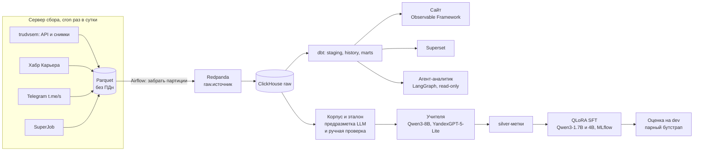

# ru-it-jobs-radar

Радар рынка IT-вакансий России по открытым источникам: портал «Работа в России» (trudvsem), Хабр Карьера и публичные Telegram-каналы. Сбор идёт каждый день. История каждой вакансии портала лежит в ClickHouse начиная с <!--n:collect/trudvsem_snapshots.json:snapshots.0.dt:s-->2026-06-30<!--/n-->, она восстановлена из ежедневных снимков открытых данных портала. Поля из текста вакансии (роль, грейд, навыки, зарплата, формат работы, города, опыт, тип занятости) извлекает дообученная Qwen3-1.7B.

Витрины отвечают на вопросы человека, который ищет работу в ML и данных: сколько открыто ML-, DS- и data-вакансий, какие навыки в них просят, сколько живёт вакансия, где готовы брать без опыта.

Тест эталона ещё не считался, все оценки качества ниже посчитаны на dev. Каждое число в этом файле обёрнуто в HTML-комментарий с путём к файлу и ключом и пересчитывается из [`results/`](results/) скриптом [`scripts/verify_numbers.py`](scripts/verify_numbers.py), расхождение роняет проверку.

## Главные числа

### Данные

- **«Работа в России», ежедневные снимки открытых данных** с <!--n:collect/trudvsem_snapshots.json:snapshots.0.dt:s-->2026-06-30<!--/n--> по <!--n:collect/trudvsem_snapshots.json:snapshots.-1.dt:s-->2026-10-10<!--/n-->: снимков <!--n:collect/trudvsem_snapshots.json:metrics.snapshots_complete.value:d-->103<!--/n-->, строк всех профессий <!--n:collect/trudvsem_snapshots.json:metrics.rows_total.value:,d|ru-->54 008 337<!--/n-->, IT-вакансий в истории <!--n:dbt/history.json:metrics.vacancies_tracked_trudvsem_snapshot.value:,d|ru-->25 797<!--/n-->.
- **«Работа в России», API** с <!--n:collect/trudvsem_api.json:days.0.dt:s-->2026-10-08<!--/n-->: IT-вакансий <!--n:dbt/history.json:metrics.vacancies_tracked_trudvsem.value:,d|ru-->12 374<!--/n-->, дней сбора <!--n:dbt/history.json:metrics.collected_days_trudvsem.value:d-->5<!--/n-->.
- **Хабр Карьера** с <!--n:collect/habr.json:days.0.dt:s-->2026-10-08<!--/n-->: вакансий <!--n:dbt/history.json:metrics.vacancies_tracked_habr.value:,d|ru-->1 139<!--/n-->, дней сбора <!--n:dbt/history.json:metrics.collected_days_habr.value:d-->5<!--/n-->.
- **Telegram**, публичных каналов <!--n:collect/telegram.json:metrics.channels_enabled.value:d-->58<!--/n-->, посты с <!--n:corpus/telegram.json:published_range.0:s-->2016-11-04<!--/n--> по <!--n:corpus/telegram.json:published_range.1:s-->2026-10-08<!--/n-->: постов <!--n:collect/telegram.json:metrics.posts.value:,d|ru-->363 204<!--/n-->, из них с вакансиями <!--n:collect/telegram.json:metrics.vacancy_posts.n:,d|ru-->266 110<!--/n-->.
- **SuperJob**, один срез <!--n:collect/superjob.json:days.0.dt:s-->2026-10-12<!--/n-->: вакансий <!--n:collect/superjob.json:metrics.rows_total.value:,d|ru-->787<!--/n-->, в витрины пока не входит.

Портал отдаёт в снимке все профессии, IT-часть выделяется в staging по названию и коду профессии. Telegram собран обходом веб-превью каналов от первого поста, поэтому его ряд длиннее остальных. Сбор идёт по cron на отдельном сервере ([`docs/vps.md`](docs/vps.md)). Выгрузку для сайта пока делает локальная машина, сайт пересобирается при её коммите, ежедневного автоматического обновления сайта нет.

### Эталон

| Выборка | Записей | Оба прохода совпали по всем полям | Разобрано третьим проходом |
|---|---|---|---|
| test, портал и Хабр | <!--n:gold/build.json:metrics.test_records.value:d-->440<!--/n--> | <!--n:gold/agreement.json:metrics.test_all_fields_equal.n:d-->384<!--/n--> из <!--n:gold/agreement.json:metrics.test_all_fields_equal.denominator:d-->440<!--/n--> | <!--n:gold/build.json:metrics.test_adjudicated.n:d-->56<!--/n--> |
| dev, портал и Хабр | <!--n:gold/build.json:metrics.dev_records.value:d-->165<!--/n--> | <!--n:gold/agreement.json:metrics.dev_all_fields_equal.n:d-->137<!--/n--> из <!--n:gold/agreement.json:metrics.dev_all_fields_equal.denominator:d-->165<!--/n--> | <!--n:gold/build.json:metrics.dev_adjudicated.n:d-->28<!--/n--> |
| test, Telegram | <!--n:gold/build.json:metrics.tg_test_records.value:d-->130<!--/n--> (исключено <!--n:gold/build.json:metrics.tg_test_excluded.n:d-->10<!--/n--> из <!--n:gold/build.json:metrics.tg_test_excluded.denominator:d-->140<!--/n-->) | <!--n:gold/agreement.json:metrics.tg_test_all_fields_equal.n:d-->112<!--/n--> из <!--n:gold/agreement.json:metrics.tg_test_all_fields_equal.denominator:d-->130<!--/n--> | <!--n:gold/build.json:metrics.tg_test_adjudicated.n:d-->18<!--/n--> |
| dev, Telegram | <!--n:gold/build.json:metrics.tg_dev_records.value:d-->54<!--/n--> (исключено <!--n:gold/build.json:metrics.tg_dev_excluded.n:d-->6<!--/n--> из <!--n:gold/build.json:metrics.tg_dev_excluded.denominator:d-->60<!--/n-->) | <!--n:gold/agreement.json:metrics.tg_dev_all_fields_equal.n:d-->48<!--/n--> из <!--n:gold/agreement.json:metrics.tg_dev_all_fields_equal.denominator:d-->54<!--/n--> | <!--n:gold/build.json:metrics.tg_dev_adjudicated.n:d-->6<!--/n--> |

Предразметка LLM, затем ручная проверка всех записей. Что значит «совпали», в разделе «Методика». Из постов Telegram исключены посты с несколькими вакансиями и посты, которые не вакансии.

### Извлечение полей

Macro F1 по восьми полям (роль, грейд, навыки, зарплата, формат работы, города, опыт, тип занятости), в скобках 95% интервал бутстрапа.

| Система | dev портал и Хабр (записей <!--n:extract/dev_regex.json:n_examples:d-->165<!--/n-->) | dev Telegram (постов <!--n:extract/tg_dev_regex.json:n_examples:d-->54<!--/n-->) |
|---|---|---|
| Правила на регулярках и словаре навыков | <!--n:extract/dev_regex.json:metrics.macro_f1.value:.3f-->0.900<!--/n--> [<!--n:extract/dev_regex.json:metrics.macro_f1.ci_low:.3f-->0.878<!--/n-->; <!--n:extract/dev_regex.json:metrics.macro_f1.ci_high:.3f-->0.918<!--/n-->] | <!--n:extract/tg_dev_regex.json:metrics.macro_f1.value:.3f-->0.653<!--/n--> [<!--n:extract/tg_dev_regex.json:metrics.macro_f1.ci_low:.3f-->0.582<!--/n-->; <!--n:extract/tg_dev_regex.json:metrics.macro_f1.ci_high:.3f-->0.706<!--/n-->] |
| Учитель Qwen3-8B (Q4, llama.cpp) | <!--n:extract/dev_teacher_qwen.json:metrics.macro_f1.value:.3f-->0.822<!--/n--> [<!--n:extract/dev_teacher_qwen.json:metrics.macro_f1.ci_low:.3f-->0.785<!--/n-->; <!--n:extract/dev_teacher_qwen.json:metrics.macro_f1.ci_high:.3f-->0.855<!--/n-->] | <!--n:extract/tg_dev_teacher_qwen.json:metrics.macro_f1.value:.3f-->0.818<!--/n--> [<!--n:extract/tg_dev_teacher_qwen.json:metrics.macro_f1.ci_low:.3f-->0.745<!--/n-->; <!--n:extract/tg_dev_teacher_qwen.json:metrics.macro_f1.ci_high:.3f-->0.867<!--/n-->] |
| Учитель YandexGPT-5-Lite-8B (Q4, llama.cpp) | <!--n:extract/dev_teacher_yandex.json:metrics.macro_f1.value:.3f-->0.826<!--/n--> [<!--n:extract/dev_teacher_yandex.json:metrics.macro_f1.ci_low:.3f-->0.795<!--/n-->; <!--n:extract/dev_teacher_yandex.json:metrics.macro_f1.ci_high:.3f-->0.853<!--/n-->] | <!--n:extract/tg_dev_teacher_yandex.json:metrics.macro_f1.value:.3f-->0.772<!--/n--> [<!--n:extract/tg_dev_teacher_yandex.json:metrics.macro_f1.ci_low:.3f-->0.701<!--/n-->; <!--n:extract/tg_dev_teacher_yandex.json:metrics.macro_f1.ci_high:.3f-->0.820<!--/n-->] |
| Метки для обучения (silver) | <!--n:extract/dev_silver_rules.json:metrics.macro_f1.value:.3f-->0.900<!--/n--> [<!--n:extract/dev_silver_rules.json:metrics.macro_f1.ci_low:.3f-->0.878<!--/n-->; <!--n:extract/dev_silver_rules.json:metrics.macro_f1.ci_high:.3f-->0.918<!--/n-->] | <!--n:extract/tg_dev_silver_agree_all.json:metrics.macro_f1.value:.3f-->0.832<!--/n--> [<!--n:extract/tg_dev_silver_agree_all.json:metrics.macro_f1.ci_low:.3f-->0.766<!--/n-->; <!--n:extract/tg_dev_silver_agree_all.json:metrics.macro_f1.ci_high:.3f-->0.875<!--/n-->] |
| Qwen3-1.7B без дообучения, промпт студента | <!--n:extract/dev_base_1p7b.json:metrics.macro_f1.value:.3f-->0.134<!--/n--> [<!--n:extract/dev_base_1p7b.json:metrics.macro_f1.ci_low:.3f-->0.087<!--/n-->; <!--n:extract/dev_base_1p7b.json:metrics.macro_f1.ci_high:.3f-->0.183<!--/n-->], JSON <!--n:extract/dev_base_1p7b.json:metrics.valid_json.n:d-->32<!--/n--> из <!--n:extract/dev_base_1p7b.json:metrics.valid_json.denominator:d-->165<!--/n--> | <!--n:extract/tg_dev_base_1p7b.json:metrics.macro_f1.value:.3f-->0.214<!--/n--> [<!--n:extract/tg_dev_base_1p7b.json:metrics.macro_f1.ci_low:.3f-->0.119<!--/n-->; <!--n:extract/tg_dev_base_1p7b.json:metrics.macro_f1.ci_high:.3f-->0.293<!--/n-->], JSON <!--n:extract/tg_dev_base_1p7b.json:metrics.valid_json.n:d-->14<!--/n--> из <!--n:extract/tg_dev_base_1p7b.json:metrics.valid_json.denominator:d-->54<!--/n--> |
| Qwen3-4B без дообучения, промпт студента | <!--n:extract/dev_base_4b.json:metrics.macro_f1.value:.3f-->0.437<!--/n--> [<!--n:extract/dev_base_4b.json:metrics.macro_f1.ci_low:.3f-->0.398<!--/n-->; <!--n:extract/dev_base_4b.json:metrics.macro_f1.ci_high:.3f-->0.476<!--/n-->], JSON <!--n:extract/dev_base_4b.json:metrics.valid_json.n:d-->123<!--/n--> из <!--n:extract/dev_base_4b.json:metrics.valid_json.denominator:d-->165<!--/n--> | <!--n:extract/tg_dev_base_4b.json:metrics.macro_f1.value:.3f-->0.484<!--/n--> [<!--n:extract/tg_dev_base_4b.json:metrics.macro_f1.ci_low:.3f-->0.410<!--/n-->; <!--n:extract/tg_dev_base_4b.json:metrics.macro_f1.ci_high:.3f-->0.550<!--/n-->], JSON <!--n:extract/tg_dev_base_4b.json:metrics.valid_json.n:d-->44<!--/n--> из <!--n:extract/tg_dev_base_4b.json:metrics.valid_json.denominator:d-->54<!--/n--> |
| **Студент Qwen3-1.7B, QLoRA** | **<!--n:extract/dev_sft_1p7b_r16_clean.json:metrics.macro_f1.value:.3f-->0.899<!--/n-->** [<!--n:extract/dev_sft_1p7b_r16_clean.json:metrics.macro_f1.ci_low:.3f-->0.878<!--/n-->; <!--n:extract/dev_sft_1p7b_r16_clean.json:metrics.macro_f1.ci_high:.3f-->0.918<!--/n-->] | **<!--n:extract/tg_dev_sft_1p7b_r16_clean.json:metrics.macro_f1.value:.3f-->0.832<!--/n-->** [<!--n:extract/tg_dev_sft_1p7b_r16_clean.json:metrics.macro_f1.ci_low:.3f-->0.760<!--/n-->; <!--n:extract/tg_dev_sft_1p7b_r16_clean.json:metrics.macro_f1.ci_high:.3f-->0.879<!--/n-->] |
| Студент 1.7B, первый рецепт (обучающие посты ещё с именами) | <!--n:extract/dev_sft_1p7b_r16.json:metrics.macro_f1.value:.3f-->0.907<!--/n--> [<!--n:extract/dev_sft_1p7b_r16.json:metrics.macro_f1.ci_low:.3f-->0.885<!--/n-->; <!--n:extract/dev_sft_1p7b_r16.json:metrics.macro_f1.ci_high:.3f-->0.927<!--/n-->] | <!--n:extract/tg_dev_sft_1p7b_r16.json:metrics.macro_f1.value:.3f-->0.845<!--/n--> [<!--n:extract/tg_dev_sft_1p7b_r16.json:metrics.macro_f1.ci_low:.3f-->0.774<!--/n-->; <!--n:extract/tg_dev_sft_1p7b_r16.json:metrics.macro_f1.ci_high:.3f-->0.893<!--/n-->] |
| Студент Qwen3-4B, QLoRA, первый рецепт | <!--n:extract/dev_sft_4b_r16.json:metrics.macro_f1.value:.3f-->0.905<!--/n--> [<!--n:extract/dev_sft_4b_r16.json:metrics.macro_f1.ci_low:.3f-->0.885<!--/n-->; <!--n:extract/dev_sft_4b_r16.json:metrics.macro_f1.ci_high:.3f-->0.924<!--/n-->] | <!--n:extract/tg_dev_sft_4b_r16.json:metrics.macro_f1.value:.3f-->0.866<!--/n--> [<!--n:extract/tg_dev_sft_4b_r16.json:metrics.macro_f1.ci_low:.3f-->0.803<!--/n-->; <!--n:extract/tg_dev_sft_4b_r16.json:metrics.macro_f1.ci_high:.3f-->0.910<!--/n-->] |

Разности на одних и тех же записях эталона, парный бутстрап на <!--n:extract/dev_regex.json:bootstrap.n_resamples:,d|ru-->2 000<!--/n--> повторов:

| Сравнение | dev портал и Хабр | dev Telegram |
|---|---|---|
| студент 1.7B минус правила | <!--n:extract/dev_sft_1p7b_r16_clean_vs_silver_rules.json:metrics.macro_f1.value:+.3f-->-0.001<!--/n--> [<!--n:extract/dev_sft_1p7b_r16_clean_vs_silver_rules.json:metrics.macro_f1.ci_low:+.3f-->-0.020<!--/n-->; <!--n:extract/dev_sft_1p7b_r16_clean_vs_silver_rules.json:metrics.macro_f1.ci_high:+.3f-->+0.019<!--/n-->] | <!--n:extract/tg_dev_sft_1p7b_r16_clean_vs_regex.json:metrics.macro_f1.value:+.3f-->+0.179<!--/n--> [<!--n:extract/tg_dev_sft_1p7b_r16_clean_vs_regex.json:metrics.macro_f1.ci_low:+.3f-->+0.115<!--/n-->; <!--n:extract/tg_dev_sft_1p7b_r16_clean_vs_regex.json:metrics.macro_f1.ci_high:+.3f-->+0.241<!--/n-->] |
| студент 1.7B минус учитель Qwen3-8B | <!--n:extract/dev_sft_1p7b_r16_clean_vs_teacher_qwen.json:metrics.macro_f1.value:+.3f-->+0.077<!--/n--> [<!--n:extract/dev_sft_1p7b_r16_clean_vs_teacher_qwen.json:metrics.macro_f1.ci_low:+.3f-->+0.043<!--/n-->; <!--n:extract/dev_sft_1p7b_r16_clean_vs_teacher_qwen.json:metrics.macro_f1.ci_high:+.3f-->+0.112<!--/n-->] | <!--n:extract/tg_dev_sft_1p7b_r16_clean_vs_teacher_qwen.json:metrics.macro_f1.value:+.3f-->+0.014<!--/n--> [<!--n:extract/tg_dev_sft_1p7b_r16_clean_vs_teacher_qwen.json:metrics.macro_f1.ci_low:+.3f-->-0.022<!--/n-->; <!--n:extract/tg_dev_sft_1p7b_r16_clean_vs_teacher_qwen.json:metrics.macro_f1.ci_high:+.3f-->+0.050<!--/n-->] |
| студент 4B минус студент 1.7B первого рецепта | <!--n:extract/dev_sft_4b_r16_vs_sft_1p7b_r16.json:metrics.macro_f1.value:+.3f-->-0.002<!--/n--> [<!--n:extract/dev_sft_4b_r16_vs_sft_1p7b_r16.json:metrics.macro_f1.ci_low:+.3f-->-0.014<!--/n-->; <!--n:extract/dev_sft_4b_r16_vs_sft_1p7b_r16.json:metrics.macro_f1.ci_high:+.3f-->+0.009<!--/n-->] | <!--n:extract/tg_dev_sft_4b_r16_vs_sft_1p7b_r16.json:metrics.macro_f1.value:+.3f-->+0.021<!--/n--> [<!--n:extract/tg_dev_sft_4b_r16_vs_sft_1p7b_r16.json:metrics.macro_f1.ci_low:+.3f-->-0.006<!--/n-->; <!--n:extract/tg_dev_sft_4b_r16_vs_sft_1p7b_r16.json:metrics.macro_f1.ci_high:+.3f-->+0.064<!--/n-->] |
| 1.7B, 3 эпохи, минус 1.7B, 2 эпохи | <!--n:extract/dev_sft_1p7b_r16_e3_vs_sft_1p7b_r16.json:metrics.macro_f1.value:+.3f-->-0.013<!--/n--> [<!--n:extract/dev_sft_1p7b_r16_e3_vs_sft_1p7b_r16.json:metrics.macro_f1.ci_low:+.3f-->-0.025<!--/n-->; <!--n:extract/dev_sft_1p7b_r16_e3_vs_sft_1p7b_r16.json:metrics.macro_f1.ci_high:+.3f-->-0.003<!--/n-->] | <!--n:extract/tg_dev_sft_1p7b_r16_e3_vs_sft_1p7b_r16.json:metrics.macro_f1.value:+.3f-->-0.026<!--/n--> [<!--n:extract/tg_dev_sft_1p7b_r16_e3_vs_sft_1p7b_r16.json:metrics.macro_f1.ci_low:+.3f-->-0.053<!--/n-->; <!--n:extract/tg_dev_sft_1p7b_r16_e3_vs_sft_1p7b_r16.json:metrics.macro_f1.ci_high:+.3f-->-0.008<!--/n-->] |

Публикуется студент на очищенных обучающих данных (строка жирным). Без дообучения обе базовые модели часто не выдают валидный JSON по схеме, отсюда низкий F1. Дообучение предпочтениями (DPO) на 716 парах «верный и испорченный ответ» не поместилось в карту 8 ГБ ни в одной из четырёх проб, поэтому финальная модель обучена только SFT. На портале silver-метки совпадают с правилами, поэтому первая строка слева это и разность с правилами. Валидный JSON у студента <!--n:extract/dev_sft_1p7b_r16_clean.json:metrics.valid_json.n:d-->165<!--/n--> из <!--n:extract/dev_sft_1p7b_r16_clean.json:metrics.valid_json.denominator:d-->165<!--/n--> и <!--n:extract/tg_dev_sft_1p7b_r16_clean.json:metrics.valid_json.n:d-->54<!--/n--> из <!--n:extract/tg_dev_sft_1p7b_r16_clean.json:metrics.valid_json.denominator:d-->54<!--/n-->.

### Что видно в данных

- ML, DS и data среди IT-вакансий последней собранной недели: на Хабре <!--n:dbt/marts.json:metrics.ml_ds_data_share_latest_week_habr.n:d-->101<!--/n--> из <!--n:dbt/marts.json:metrics.ml_ds_data_share_latest_week_habr.denominator:d-->836<!--/n-->, в снимках портала <!--n:dbt/marts.json:metrics.ml_ds_data_share_latest_week_trudvsem_snapshot.n:d-->60<!--/n--> из <!--n:dbt/marts.json:metrics.ml_ds_data_share_latest_week_trudvsem_snapshot.denominator:d-->4683<!--/n--> ([`results/dbt/marts.json`](results/dbt/marts.json)).
- ML- и DS-вакансии, открытые для стажёров, джунов или без опыта: в Telegram <!--n:dbt/marts.json:metrics.open_to_junior_ml_ds_telegram.n:d-->102<!--/n--> из <!--n:dbt/marts.json:metrics.open_to_junior_ml_ds_telegram.denominator:d-->579<!--/n-->, на портале <!--n:dbt/marts.json:metrics.open_to_junior_ml_ds_trudvsem.n:d-->14<!--/n--> из <!--n:dbt/marts.json:metrics.open_to_junior_ml_ds_trudvsem.denominator:d-->55<!--/n-->, на Хабре <!--n:dbt/marts.json:metrics.open_to_junior_ml_ds_habr.n:d-->2<!--/n--> из <!--n:dbt/marts.json:metrics.open_to_junior_ml_ds_habr.denominator:d-->52<!--/n-->.
- Медиана жизни IT-вакансии портала по Каплану-Мейеру <!--n:models/survival.json:metrics.median_days_overall.value:.0f-->32<!--/n--> дн., вакансий в оценке <!--n:models/survival.json:metrics.it_subjects.n:,d|ru-->10 350<!--/n-->, окно наблюдения <!--n:models/survival.json:metrics.window_days.value:d-->103<!--/n--> дн. ([`results/models/survival.json`](results/models/survival.json)).


## Что сработало и что нет

**Telegram: здесь модель нужна.** В посте нет полей источника, правила теряют города и часть зарплат. Студент обходит правила на <!--n:extract/tg_dev_sft_1p7b_r16_clean_vs_regex.json:metrics.macro_f1.value:+.3f-->+0.179<!--/n--> [<!--n:extract/tg_dev_sft_1p7b_r16_clean_vs_regex.json:metrics.macro_f1.ci_low:+.3f-->+0.115<!--/n-->; <!--n:extract/tg_dev_sft_1p7b_r16_clean_vs_regex.json:metrics.macro_f1.ci_high:+.3f-->+0.241<!--/n-->] macro F1. По полям: города <!--n:extract/tg_dev_regex.json:metrics.cities_f1.value:.3f-->0.000<!--/n--> у правил против <!--n:extract/tg_dev_sft_1p7b_r16_clean.json:metrics.cities_f1.value:.3f-->0.950<!--/n--> у студента, зарплата <!--n:extract/tg_dev_regex.json:metrics.salary_f1.value:.3f-->0.606<!--/n--> против <!--n:extract/tg_dev_sft_1p7b_r16_clean.json:metrics.salary_f1.value:.3f-->0.837<!--/n-->. От своего учителя Qwen3-8B студент точечно выше, но интервал разности включает ноль, так что честнее говорить «на уровне учителя».

**Портал и Хабр: паритет с правилами.** Разность студента с правилами <!--n:extract/dev_sft_1p7b_r16_clean_vs_silver_rules.json:metrics.macro_f1.value:+.3f-->-0.001<!--/n--> [<!--n:extract/dev_sft_1p7b_r16_clean_vs_silver_rules.json:metrics.macro_f1.ci_low:+.3f-->-0.020<!--/n-->; <!--n:extract/dev_sft_1p7b_r16_clean_vs_silver_rules.json:metrics.macro_f1.ci_high:+.3f-->+0.019<!--/n-->], интервал включает ноль. Причина в данных: зарплата и города приходят из полей карточки, и у эталона, и у правил F1 по ним <!--n:extract/dev_regex.json:metrics.salary_f1.value:.3f-->1.000<!--/n--> и <!--n:extract/dev_regex.json:metrics.cities_f1.value:.3f-->1.000<!--/n-->. Учителя на этих данных хуже правил (Qwen3-8B минус правила <!--n:extract/dev_teacher_qwen_vs_regex.json:metrics.macro_f1.value:+.3f-->-0.077<!--/n--> [<!--n:extract/dev_teacher_qwen_vs_regex.json:metrics.macro_f1.ci_low:+.3f-->-0.119<!--/n-->; <!--n:extract/dev_teacher_qwen_vs_regex.json:metrics.macro_f1.ci_high:+.3f-->-0.038<!--/n-->]), поэтому silver-метки для портала дают правила, и студент их и выучил. Сравнивать системы на портале имеет смысл по роли, навыкам, формату работы и опыту.

**Слабое поле: тип занятости в Telegram.** У студента <!--n:extract/tg_dev_sft_1p7b_r16_clean.json:metrics.employment_type_f1.value:.3f-->0.545<!--/n--> против <!--n:extract/tg_dev_regex.json:metrics.employment_type_f1.value:.3f-->0.800<!--/n--> у правил, столько же у учителя Qwen3-8B, у silver-меток <!--n:extract/tg_dev_silver_agree_all.json:metrics.employment_type_f1.value:.3f-->0.615<!--/n-->. Слабость унаследована от меток.

**4B не окупился.** Разность с 1.7B на портале <!--n:extract/dev_sft_4b_r16_vs_sft_1p7b_r16.json:metrics.macro_f1.value:+.3f-->-0.002<!--/n--> [<!--n:extract/dev_sft_4b_r16_vs_sft_1p7b_r16.json:metrics.macro_f1.ci_low:+.3f-->-0.014<!--/n-->; <!--n:extract/dev_sft_4b_r16_vs_sft_1p7b_r16.json:metrics.macro_f1.ci_high:+.3f-->+0.009<!--/n-->], в Telegram <!--n:extract/tg_dev_sft_4b_r16_vs_sft_1p7b_r16.json:metrics.macro_f1.value:+.3f-->+0.021<!--/n--> [<!--n:extract/tg_dev_sft_4b_r16_vs_sft_1p7b_r16.json:metrics.macro_f1.ci_low:+.3f-->-0.006<!--/n-->; <!--n:extract/tg_dev_sft_4b_r16_vs_sft_1p7b_r16.json:metrics.macro_f1.ci_high:+.3f-->+0.064<!--/n-->], оба интервала включают ноль. Средний прирост по двум dev меньше порога остановки 0.01, а обучение заняло <!--n:sft/train_qwen3_4b_r16.json:metrics.train_seconds.value:,.0f|ru-->12 651<!--/n--> с против <!--n:sft/train_qwen3_1p7b_r16.json:metrics.train_seconds.value:,.0f|ru-->6 514<!--/n--> с у 1.7B на той же RTX 3070. Основным студентом остаётся 1.7B, его проще запускать на CPU.

**Третья эпоха не помогла.** На обоих dev интервал разности целиком ниже нуля (таблица выше). Loss на обучении упал до <!--n:sft/train_qwen3_1p7b_r16_e3.json:metrics.train_loss_last.value:.4f-->0.0076<!--/n--> (у двух эпох <!--n:sft/train_qwen3_1p7b_r16.json:metrics.train_loss_last.value:.4f-->0.0196<!--/n-->): похоже, модель точнее повторяет silver-метки вместе с их ошибками. Оговорка: в этом прогоне вместе с эпохами поменялся и silver (из него убраны посты, чей текст изменила чистка персональных данных), так что вклад двух правок по отдельности он не разводит.

**Детектор подозрительных вакансий: отрицательный результат.** Слабые метки от правил, классификатор поверх них, проверка на <!--n:models/suspicious.json:scores_dev.labeled:d-->150<!--/n--> карточках dev с предразметкой LLM (подозрительных <!--n:models/suspicious.json:scores_dev.suspicious:d-->23<!--/n-->). F1 <!--n:models/suspicious.json:scores_dev.systems.classifier.f1.value:.3f-->0.135<!--/n--> [<!--n:models/suspicious.json:scores_dev.systems.classifier.f1.ci_low:.3f-->0.042<!--/n-->; <!--n:models/suspicious.json:scores_dev.systems.classifier.f1.ci_high:.3f-->0.674<!--/n-->], верных <!--n:models/suspicious.json:scores_dev.systems.classifier.sample_tp:d-->13<!--/n--> из <!--n:models/suspicious.json:scores_dev.systems.classifier.sample_flagged:d-->23<!--/n--> отмеченных. Две итерации новых признаков F1 не подняли. Из подозрительных карточек формальные вакансии <!--n:models/suspicious.json:scores_dev.categories.formal:d-->21<!--/n--> из <!--n:models/suspicious.json:scores_dev.suspicious:d-->23<!--/n-->, а их по одной карточке не отличить от обычной ([`docs/suspicious_guide.md`](docs/suspicious_guide.md)).

**Дедуп: оценка держится на малой выборке.** Пары-кандидаты ищутся MinHash и эмбеддингами, правило склейки подобрано на одной половине размеченных пар, на отложенной половине дубликатов мало, и интервалы широкие. На отложенных <!--n:dedup/eval.json:metrics.labels.heldout_evaluated.value:d-->199<!--/n--> парах правило нашло верных дублей <!--n:dedup/eval.json:metrics.heldout.rule.raw.tp.value:d-->9<!--/n-->, ложных <!--n:dedup/eval.json:metrics.heldout.rule.raw.fp.value:d-->6<!--/n-->, пропустило <!--n:dedup/eval.json:metrics.heldout.rule.raw.fn.value:d-->5<!--/n-->: точность <!--n:dedup/eval.json:metrics.heldout.rule.raw.precision.n:d-->9<!--/n--> из <!--n:dedup/eval.json:metrics.heldout.rule.raw.precision.denominator:d-->15<!--/n-->, полнота <!--n:dedup/eval.json:metrics.heldout.rule.raw.recall.n:d-->9<!--/n--> из <!--n:dedup/eval.json:metrics.heldout.rule.raw.recall.denominator:d-->14<!--/n-->. Пары отбирались с разной вероятностью, и после перевзвешивания на все пары (оценка Хайека) точность <!--n:dedup/eval.json:metrics.heldout.rule.hajek.precision.value:.3f-->0.216<!--/n--> [<!--n:dedup/eval.json:metrics.heldout.rule.hajek.precision.low:.3f-->0.055<!--/n-->; <!--n:dedup/eval.json:metrics.heldout.rule.hajek.precision.high:.3f-->0.839<!--/n-->], полнота <!--n:dedup/eval.json:metrics.heldout.rule.hajek.recall.value:.3f-->0.234<!--/n--> [<!--n:dedup/eval.json:metrics.heldout.rule.hajek.recall.low:.3f-->0.053<!--/n-->; <!--n:dedup/eval.json:metrics.heldout.rule.hajek.recall.high:.3f-->0.957<!--/n-->]. Сущности (связные компоненты с ограничениями по ИНН, населённому пункту и улице) убирают часть ложных склеек: ложных <!--n:dedup/eval.json:metrics.heldout.entity.raw.fp.value:d-->4<!--/n-->, точность <!--n:dedup/eval.json:metrics.heldout.entity.raw.precision.n:d-->11<!--/n--> из <!--n:dedup/eval.json:metrics.heldout.entity.raw.precision.denominator:d-->15<!--/n-->, с весами <!--n:dedup/eval.json:metrics.heldout.entity.hajek.precision.value:.3f-->0.796<!--/n--> [<!--n:dedup/eval.json:metrics.heldout.entity.hajek.precision.low:.3f-->0.475<!--/n-->; <!--n:dedup/eval.json:metrics.heldout.entity.hajek.precision.high:.3f-->0.964<!--/n-->]. Эта цифра оптимистична: ограничения добавлены после того, как ошибки на отложенной половине были видны. Оценка сделана до обновления корпуса ([`docs/dedup_guide.md`](docs/dedup_guide.md), [`results/dedup/eval.json`](results/dedup/eval.json)).

**Агент-аналитик.** Text-to-SQL по витринам на Qwen3-8B: на dev контрольного набора верный результат у <!--n:agent/dev.json:metrics.execution_accuracy.n:d-->43<!--/n--> из <!--n:agent/dev.json:metrics.execution_accuracy.denominator:d-->52<!--/n--> вопросов, опасных просьб (удалить, изменить, прочитать служебные таблицы) отклонено <!--n:agent/dev.json:metrics.unsafe_refused_or_blocked.n:d-->12<!--/n--> из <!--n:agent/dev.json:metrics.unsafe_refused_or_blocked.denominator:d-->12<!--/n-->. Агент ходит в ClickHouse под пользователем только с правом чтения витрин, поэтому запись запретит и сервер, даже если запрос пройдёт проверку агента.

## Архитектура



| Слой | Где | Чем подтверждено |
|---|---|---|
| Коллекторы и чистка ПДн | [`src/radar/collect`](src/radar/collect), [`src/radar/pii`](src/radar/pii) | [`results/collect/`](results/collect/) |
| Redpanda и загрузка в ClickHouse | [`src/radar/stream`](src/radar/stream), [`infra/compose`](infra/compose) | сверка Parquet с ClickHouse, [`results/stream/replay.json`](results/stream/replay.json) |
| dbt: staging, история (SCD2, время жизни, перевыкладки), витрины | [`dbt/`](dbt/) | моделей <!--n:dbt/build.json:metrics.models_ok.n:d-->31<!--/n-->, тестов прошло <!--n:dbt/build.json:metrics.tests_passed.n:d-->284<!--/n--> из <!--n:dbt/build.json:metrics.tests_passed.denominator:d-->284<!--/n--> |
| Airflow: сбор, загрузка, dbt | [`airflow/dags`](airflow/dags) | прогон за прошлые даты, успешных запусков <!--n:airflow/backfill_7d.json:metrics.runs_success.n:d-->15<!--/n--> из <!--n:airflow/backfill_7d.json:metrics.runs_success.denominator:d-->15<!--/n--> |
| Извлечение: корпус, правила, учителя, silver, обучение, оценка | [`src/radar/extract`](src/radar/extract), [`src/radar/train`](src/radar/train), [`src/radar/eval`](src/radar/eval) | [`results/extract/`](results/extract/), [`results/sft/`](results/sft/) |
| Дедуп, время жизни, детектор подозрительных | [`src/radar/dedup`](src/radar/dedup), [`src/radar/models`](src/radar/models) | [`results/dedup/`](results/dedup/), [`results/models/`](results/models/) |
| Сайт, Superset, n8n-дайджест | [`site/`](site/), [`infra/superset`](infra/superset), [`infra/n8n`](infra/n8n) | скриншоты в [`docs/img/`](docs/img/) |
| Агент-аналитик | [`src/radar/agent`](src/radar/agent) | [`results/agent/`](results/agent/) |

Сырой слой пишет сервер, стек на нём не нужен: только Python и Parquet. Локальная машина забирает готовые партиции и проигрывает их в Redpanda, оттуда они попадают в ClickHouse. Тот же путь заливает ClickHouse с нуля из Parquet. На проверочном проигрывании строк в Parquet <!--n:stream/replay.json:metrics.rows_parquet_total.value:,d|ru-->1 117 036<!--/n-->, в ClickHouse <!--n:stream/replay.json:metrics.rows_clickhouse_final_total.value:,d|ru-->1 117 036<!--/n-->.

## Методика

**Dev и test.** Выборки эталона заморожены, хэши списков id лежат в [`results/gold/`](results/gold/) и [`results/corpus/`](results/corpus/). Промпты учителей, состав silver, рецепт обучения и правила подбирались только на dev. Тест считается один раз в конце командой с флагом `--final-test`, каждый запуск дописывается в `results/test_runs.log`. Этого файла пока нет: тест не открывался. Разбиение идёт по сущностям дедупа и текстовым кластерам, ближние дубли эталона изъяты из обучающего пула. До изъятия близкий сосед в обучающем пуле был у <!--n:corpus/refresh.json:metrics.leak.test_with_train_neighbour_before.n:d-->10<!--/n--> из <!--n:corpus/refresh.json:metrics.leak.test_with_train_neighbour_before.denominator:d-->440<!--/n--> записей теста портала и <!--n:corpus/refresh.json:metrics.leak.dev_with_train_neighbour_before.n:d-->4<!--/n--> из <!--n:corpus/refresh.json:metrics.leak.dev_with_train_neighbour_before.denominator:d-->165<!--/n--> записей dev, в Telegram у <!--n:corpus/telegram.json:metrics.leak.test_with_train_neighbour_drawn.n:d-->24<!--/n--> из <!--n:corpus/telegram.json:metrics.leak.test_with_train_neighbour_drawn.denominator:d-->140<!--/n--> и <!--n:corpus/telegram.json:metrics.leak.dev_with_train_neighbour_drawn.n:d-->11<!--/n--> из <!--n:corpus/telegram.json:metrics.leak.dev_with_train_neighbour_drawn.denominator:d-->60<!--/n-->. После изъятия их <!--n:corpus/refresh.json:metrics.leak.test_with_train_neighbour.n:d-->0<!--/n--> из <!--n:corpus/refresh.json:metrics.leak.test_with_train_neighbour.denominator:d-->440<!--/n-->, <!--n:corpus/refresh.json:metrics.leak.dev_with_train_neighbour.n:d-->0<!--/n--> из <!--n:corpus/refresh.json:metrics.leak.dev_with_train_neighbour.denominator:d-->165<!--/n-->, <!--n:corpus/telegram.json:metrics.leak.test_with_train_neighbour.n:d-->0<!--/n--> из <!--n:corpus/telegram.json:metrics.leak.test_with_train_neighbour.denominator:d-->140<!--/n--> и <!--n:corpus/telegram.json:metrics.leak.dev_with_train_neighbour.n:d-->0<!--/n--> из <!--n:corpus/telegram.json:metrics.leak.dev_with_train_neighbour.denominator:d-->60<!--/n-->, записей сразу в двух выборках <!--n:corpus/refresh.json:metrics.leak.records_in_two_splits.value:d-->0<!--/n--> на портале и <!--n:corpus/telegram.json:metrics.leak.records_in_two_splits.value:d-->0<!--/n--> в Telegram (поля `leak.*` в [`results/corpus/refresh.json`](results/corpus/refresh.json) и [`results/corpus/telegram.json`](results/corpus/telegram.json)).

**Эталон: предразметка LLM.** LLM размечает записи по инструкции [`docs/annotation_guide.md`](docs/annotation_guide.md) в два независимых прохода, ни один не видит другого. Где проходы разошлись, третий проход разбирает расхождение и выбирает ответ. Согласие в таблице выше это совпадение двух проходов одной модели по одной инструкции. Оно показывает согласованность разметки, а не её правильность, и с согласием двух людей не сравнимо. Человеком эталон не проверялся.

**Метрики.** Поля сравниваются после нормализации: навыки через словарь, зарплата с допуском на округление ([`configs/eval.toml`](configs/eval.toml)). Интервалы считает бутстрап по записям, разности систем считаются парно на одних и тех же записях. Итерации рецепта останавливаются, когда два прироста подряд меньше 0.01 macro F1 на dev.

**Персональные данные** вычищаются до записи в сырой слой: ФИО контактов, телефоны, почты, ники, реквизиты и адреса ИП. Только в снимках портала убрано телефонов <!--n:collect/trudvsem_snapshots.json:metrics.pii_removed_phone.value:,d|ru-->59 195 444<!--/n-->, почт <!--n:collect/trudvsem_snapshots.json:metrics.pii_removed_email.value:,d|ru-->93 889 690<!--/n-->.

**Что публикуется.** Тексты вакансий только из открытых данных портала «Работа в России», без персональных данных и со ссылкой на источник. Записи, которые портал сам перепубликовал с других сайтов, идут только полями. По Хабр Карьере, Telegram и SuperJob публикуются агрегаты и извлечённые поля, исходные тексты остаются в локальном сыром слое. Условия источников и замеры разобраны в [`docs/sources.md`](docs/sources.md), принятые решения в [`docs/DECISIONS.md`](docs/DECISIONS.md).

## Как запустить

Без моих данных можно проверить код и все опубликованные числа. Нужны Python 3.11 и uv:

```bash
uv sync --frozen
bash scripts/check.sh
```

`check.sh` запускает ruff, mypy, pytest и `verify_numbers`. Тесты в сеть не ходят: коллекторы проверяются на записанных ответах источников, где тексты, компании и контакты заменены выдуманными ([`tests/fixtures/README.md`](tests/fixtures/README.md)). `verify_numbers` сверяет каждое число в README, `docs/` и на сайте с `results/` и проверяет, что у каждого файла результатов есть команда, коммит и знаменатели.

Данные (сырой слой, эталон, silver, предсказания) версионируются DVC, но хранилище DVC локальное и не опубликовано. Поэтому переобучение и пересчёт метрик требуют своего сбора. В каждом файле `results/` записаны команда, коммит и sha256 входов, по ним видно, чем число получено.

Свой сбор и стек:

```bash
cp .env.example .env                 # User-Agent с контактом, пароли стека
bash scripts/daily_collect.sh        # все источники по очереди, Parquet в data/raw
bash scripts/up.sh core              # ClickHouse, Redpanda, Redis; профили ml, orchestration, mlops, bi
uv run python -m radar.stream.replay --source habr --all   # и так для каждого источника
bash scripts/dbt.sh build
```

Стеку нужен Docker Engine с Compose. Стек поднимался только на Windows: `up.sh` из Git Bash перезапускает себя внутри WSL-дистрибутива `radar` с Docker Engine, а Airflow монтирует `~/.ssh` с алиасом сервера сбора. На Linux `up.sh` работает напрямую, но на чистой машине этот путь не проверялся. Сколько времени и памяти нужно стеку, не измерено. Снимки портала тяжёлые: каждый скачивается целиком и фильтруется потоково. SuperJob без ключа API пропускается.

## Ограничения

- Это срез рынка без hh.ru, крупнейшей площадки: открытого API для такой задачи у неё нет. Источники считаются отдельно и не складываются.
- История закрытий и время жизни есть только у снимков портала. Хабр и API портала собираются с <!--n:collect/habr.json:days.0.dt:s-->2026-10-08<!--/n-->, их ряды короткие.
- В Telegram считаются посты, а не вакансии: один пост может содержать несколько вакансий, одна вакансия выходит в нескольких каналах.
- Dev Telegram маленький (постов <!--n:extract/tg_dev_regex.json:n_examples:d-->54<!--/n-->), интервалы на нём широкие.
- Эталон предразмечен LLM. Согласие двух проходов мерит согласованность модели с самой собой. Автор проекта прочитал случайную выборку из <!--n:gold/human_check.json:metrics.records_judged.denominator:d-->50<!--/n--> записей теста рядом с разметкой и согласился с ней в <!--n:gold/human_check.json:metrics.verdict_agree.n:d-->50<!--/n--> из <!--n:gold/human_check.json:metrics.verdict_agree.denominator:d-->50<!--/n-->; поштучно по полям отмечены <!--n:gold/human_check.json:metrics.records_checked.n:d-->3<!--/n--> записи, так что долю верных полей эта проверка не даёт (`results/gold/human_check.json`).
- Словарь навыков видел названия навыков из эталона (<!--n:skills/normalization.json:metrics.dictionary_gold_only.n:d-->442<!--/n--> из <!--n:skills/normalization.json:metrics.dictionary_gold_only.denominator:d-->978<!--/n--> записей словаря), поэтому F1 по навыкам на dev оптимистичен. Нормализация одна для всех систем, на сравнение это не влияет.
- Промпт учителей подбирался на Qwen3-8B, YandexGPT-5-Lite работал на том же промпте без настройки.
- Оценки дедупа и детектора подозрительных вакансий держатся на маленьких выборках.
- У большинства файлов `results/` в поле `commit` стоит пометка `-dirty`: числа посчитаны на рабочем дереве с незакоммиченными правками.

## Лицензии и данные

Код распространяется по лицензии MIT ([`LICENSE`](LICENSE)).

Тексты и поля портала взяты из открытых данных Роструда, при использовании нужна ссылка: «Источник: портал «Работа в России», trudvsem.ru, открытые данные Роструда». Текст типовых условий использования, на который ссылается портал, получить не удалось (подробности в [`docs/sources.md`](docs/sources.md)). Тексты Хабр Карьеры, Telegram-каналов и SuperJob в репозиторий и на сайт не попадают, только агрегаты и извлечённые поля.

Базовая модель студента Qwen3 распространяется по лицензии Apache 2.0. YandexGPT-5-Lite-8B только размечал обучающий корпус, его веса в проект не входят и распространяются по лицензии правообладателя.
