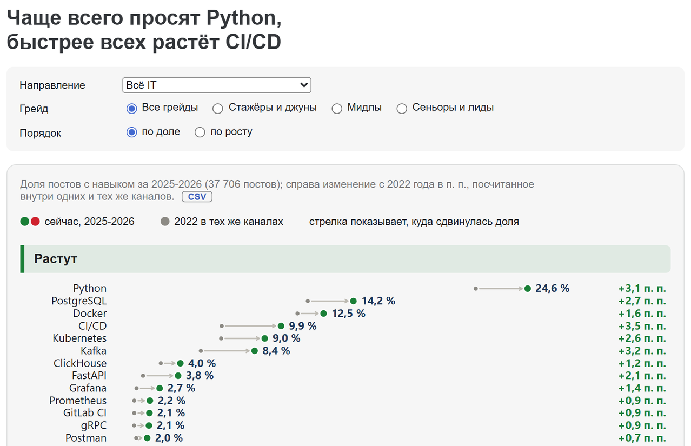
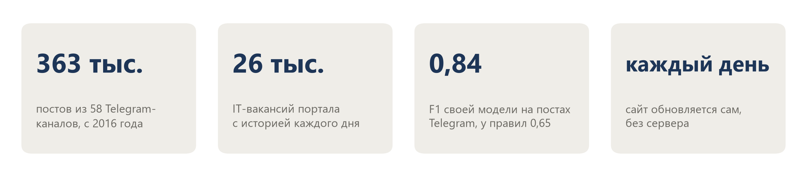
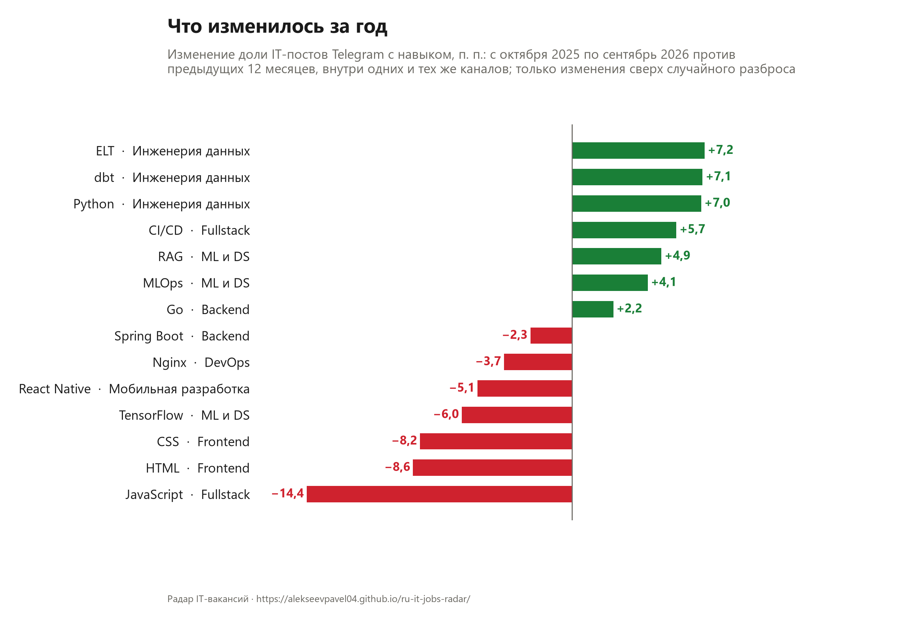
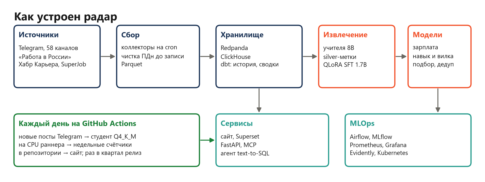
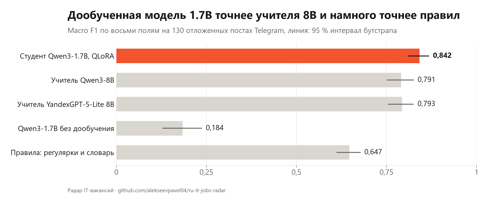
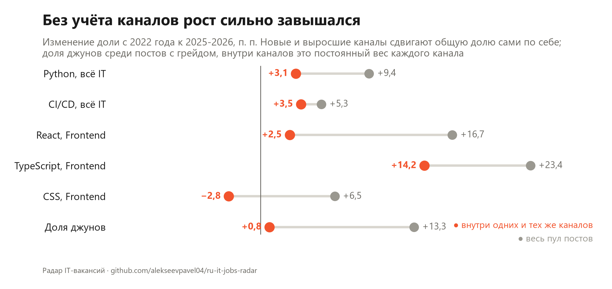

# ru-it-jobs-radar

Радар рынка IT-вакансий России. Каждый день собирает вакансии из публичных Telegram-каналов, портала «Работа в России», Хабр Карьеры и SuperJob, читает их своей дообученной моделью и показывает на сайте, какие навыки просят, как меняется спрос на них и за что платят больше.

**[Сайт](https://alekseevpavel04.github.io/ru-it-jobs-radar/)** · [квартальные срезы](https://github.com/alekseevpavel04/ru-it-jobs-radar/releases) · [модель](https://huggingface.co/alekseevpavel04/ru-it-vacancy-extractor-qwen3-1.7b) · [датасет](https://huggingface.co/datasets/alekseevpavel04/ru-it-vacancies) · [демо модели в браузере](https://huggingface.co/spaces/alekseevpavel04/ru-it-jobs-radar)

[](https://alekseevpavel04.github.io/ru-it-jobs-radar/)



В Telegram <!--n:collect/telegram.json:metrics.posts.value:,d|ru-->363 204<!--/n--> поста из <!--n:collect/telegram.json:metrics.channels_enabled.value:d-->58<!--/n--> каналов, на портале <!--n:dbt/history.json:metrics.vacancies_tracked_trudvsem_snapshot.value:,d|ru-->25 992<!--/n--> IT-вакансии с историей каждого дня. Своя модель Qwen3-1.7B читает посты Telegram с macro F1 <!--n:extract/final_test.json:metrics.tg_test/sft_1p7b_r16_clean/macro_f1.value:.3f|ru-->0,842<!--/n--> против <!--n:extract/final_test.json:metrics.tg_test/regex/macro_f1.value:.3f|ru-->0,647<!--/n--> у правил. Сайт обновляется сам каждый день на бесплатном раннере GitHub, без моего сервера. Каждое число в README и документах пересчитывается из [`results/`](results/) скриптом [`verify_numbers.py`](scripts/verify_numbers.py), расхождение роняет проверку.

## Что видно в данных



За год с октября 2025 по сентябрь 2026 против предыдущего года, внутри одних и тех же каналов ([полный срез](docs/quarterly/2026Q3.md)):

- в ML и Data Science растут RAG (<!--n:quarterly/2026Q3.json:metrics.change.ml.RAG.value:+.1f|pct|ru-->+4,9<!--/n--> п. п.) и MLOps (<!--n:quarterly/2026Q3.json:metrics.change.ml.MLOps.value:+.1f|pct|ru-->+4,1<!--/n-->), TensorFlow теряет <!--n:quarterly/2026Q3.json:metrics.change.ml.TensorFlow.value:+.1f|pct|ru-->-6,0<!--/n-->;
- в инженерии данных растут dbt (<!--n:quarterly/2026Q3.json:metrics.change.dataeng.dbt.value:+.1f|pct|ru-->+7,1<!--/n-->) и ELT (<!--n:quarterly/2026Q3.json:metrics.change.dataeng.ELT.value:+.1f|pct|ru-->+7,2<!--/n-->);
- при одинаковых роли, грейде, регионе и остальном стеке вилка выше с 1С:ERP (<!--n:models/skill_effects.json:metrics.effect.1С_ERP.pct:+.1f|ru-->+20,4<!--/n--> %) и Linux (<!--n:models/skill_effects.json:metrics.effect.Linux.pct:+.1f|ru-->+9,0<!--/n--> %), ниже с MS Office (<!--n:models/skill_effects.json:metrics.effect.MS Office.pct:+.1f|ru-->-15,1<!--/n--> %).

## Как устроено



Коллекторы на сервере каждый день пишут сырой слой в Parquet, вычищая персональные данные до записи. Оттуда данные идут через Redpanda в ClickHouse, dbt строит историю каждой вакансии и сводные таблицы. Поля вакансии (роль, грейд, навыки, зарплата, формат работы, города, опыт, тип занятости) извлекает студент Qwen3-1.7B, дообученный на разметке двух учителей 8B. Поверх полей работают модель зарплаты с интервалом, оценка вклада навыка в вилку, подбор вакансий под резюме и агент, который отвечает на вопросы по данным SQL-запросами. Сайт для Telegram обновляет отдельный автопилот на GitHub Actions.

**Стек:** Python, ClickHouse, dbt, Redpanda (Kafka), Airflow, n8n, Spark, PyTorch, QLoRA, llama.cpp, vLLM, MLflow, DVC, FastAPI, MCP, LangGraph, Redis, Prometheus, Grafana, Evidently, Superset, Docker, Kubernetes (Helm, kind), GitHub Actions, Observable Framework.

## Модель извлечения



Студент обучен на silver-метках двух учителей (Qwen3-8B и YandexGPT-5-Lite-8B) и проверен на эталоне, который подбор ни разу не видел. На отложенных постах Telegram он точнее правил на <!--n:extract/final_test.json:metrics.tg_test/sft_1p7b_r16_clean_minus_regex/macro_f1.value:+.3f|ru-->+0,194<!--/n--> macro F1 [<!--n:extract/final_test.json:metrics.tg_test/sft_1p7b_r16_clean_minus_regex/macro_f1.ci_low:+.3f|ru-->+0,164<!--/n-->; <!--n:extract/final_test.json:metrics.tg_test/sft_1p7b_r16_clean_minus_regex/macro_f1.ci_high:+.3f|ru-->+0,225<!--/n-->]. Квантованная Q4_K_M весит <!--n:public/hf_model.json:metrics.gguf_q4_k_m_mib.value:,.0f|ru-->1 056<!--/n--> МиБ и работает на процессоре, в API и в браузере. Таблицы на test, подбор рецепта на dev и эталон в [`docs/extraction.md`](docs/extraction.md).

## Где данные пытались обмануть



- **Состав каналов.** По общему пулу постов Python рос на <!--n:market/composition.json:metrics.pooled.it_all.Python.value:+.1f|pct|ru-->+9,4<!--/n--> п. п., внутри одних и тех же каналов на <!--n:market/composition.json:metrics.within.it_all.Python.value:+.1f|pct|ru-->+3,1<!--/n-->: новые и выросшие каналы сдвигали доли сами. Теперь все изменения считаются внутри каналов.
- **Тест по постам.** Посты одного канала не независимы, и обычный тест на плацебо находил «значимую» разницу у <!--n:market/composition.json:metrics.placebo.pooled_test.n:,d|ru-->10 218<!--/n--> из <!--n:market/composition.json:metrics.placebo.pooled_test.denominator:,d|ru-->12 000<!--/n--> сравнений. Новое правило срабатывает на плацебо у <!--n:market/within_placebo.json:metrics.flagged_at_5pct.rule.value:.1f|pct|ru-->2,6<!--/n--> % при номинале 5 %.
- **Резюме как вакансии.** Канал перешёл на подборки резюме, и правило сбора считало их вакансиями: <!--n:market/composition.json:metrics.resume_posts.2025.value:,d|ru-->3 028<!--/n--> постов за 2025 год.

Все найденные проблемы, от API портала до токенизатора llama.cpp, по этапам, с числами и тем, что сделано, в [`docs/data_problems.md`](docs/data_problems.md).

## Документация

| Документ | О чём |
|---|---|
| [`data_problems.md`](docs/data_problems.md) | Проблемы с данными по этапам: что случилось, как заметили, что сделано |
| [`extraction.md`](docs/extraction.md) | Модель извлечения: эталон, результаты на test, подбор на dev |
| [`models.md`](docs/models.md) | Зарплата с интервалом, навык и вилка, подбор вакансий, прогноз спроса, дедуп |
| [`autopilot.md`](docs/autopilot.md) | Как сайт обновляется сам и чем это проверено, квартальный срез |
| [`platform.md`](docs/platform.md) | Архитектура по слоям, API, MCP, агент, MLflow, мониторинг, Kubernetes |
| [`data.md`](docs/data.md) | Источники и объёмы, что публикуется, персональные данные, лицензии |
| [`limitations.md`](docs/limitations.md) | Ограничения и что не сработало (DPO, реранкер, детектор подозрительных вакансий) |
| [`running.md`](docs/running.md) | Как проверить код и числа, как поднять свой сбор и стек |
| [`DECISIONS.md`](docs/DECISIONS.md) | Принятые решения и почему |

## Как запустить

```bash
uv sync --frozen
bash scripts/check.sh    # ruff, mypy, pytest и пересчёт всех опубликованных чисел
```

Тесты в сеть не ходят. Свой сбор и стек описаны в [`docs/running.md`](docs/running.md).

## In English

A daily radar of the Russian IT job market. Collectors pull public Telegram channels and three job portals into a ClickHouse and dbt warehouse; a Qwen3-1.7B fine-tuned with QLoRA on labels from two 8B teachers turns vacancy text into eight fields (role, grade, skills, salary, work format, cities, experience, employment type). On held-out Telegram posts it reaches macro F1 <!--n:extract/final_test.json:metrics.tg_test/sft_1p7b_r16_clean/macro_f1.value:.3f-->0.842<!--/n--> against <!--n:extract/final_test.json:metrics.tg_test/regex/macro_f1.value:.3f-->0.647<!--/n--> for rules. On top of the fields sit a salary model with conformal intervals, skill-to-pay effects via double ML, vacancy matching and a text-to-SQL agent. The skills site rebuilds itself every day on a free GitHub Actions runner. The documentation is in Russian.

## Лицензия

Код распространяется по лицензии MIT ([`LICENSE`](LICENSE)). Данные портала взяты из открытых данных Роструда, условия источников в [`docs/data.md`](docs/data.md).
