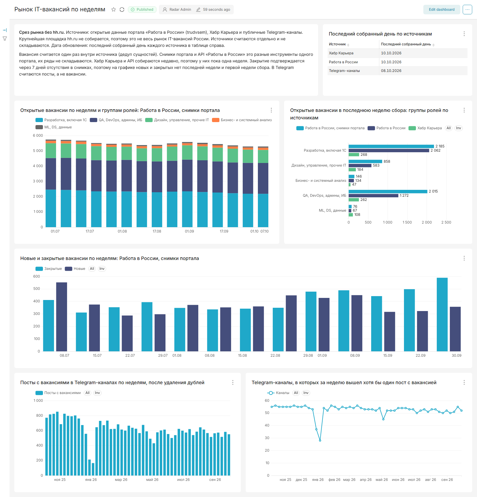
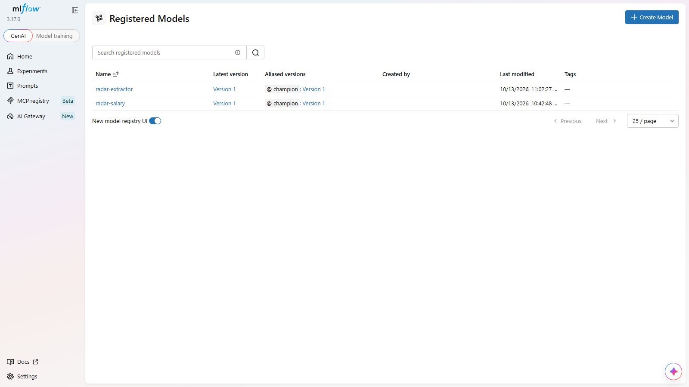
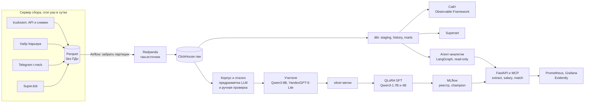

# ru-it-jobs-radar

Радар рынка IT-вакансий России по открытым источникам: портал «Работа в России» (trudvsem), Хабр Карьера и публичные Telegram-каналы. Сбор идёт каждый день. История каждой вакансии портала лежит в ClickHouse начиная с <!--n:collect/trudvsem_snapshots.json:snapshots.0.dt:s-->2026-06-30<!--/n-->, она восстановлена из ежедневных снимков открытых данных портала. Поля из текста вакансии (роль, грейд, навыки, зарплата, формат работы, города, опыт, тип занятости) извлекает дообученная Qwen3-1.7B. Поверх полей работают модель зарплаты, подбор вакансий под резюме, прогноз спроса на навыки и агент-аналитик.

Витрины отвечают на вопросы человека, который ищет работу в ML и данных: сколько открыто ML-, DS- и data-вакансий, какие навыки в них просят, сколько живёт вакансия, где готовы брать без опыта.

- Сайт: <https://alekseevpavel04.github.io/ru-it-jobs-radar/>
- Модель: <https://huggingface.co/alekseevpavel04/ru-it-vacancy-extractor-qwen3-1.7b>
- Датасет: <https://huggingface.co/datasets/alekseevpavel04/ru-it-vacancies>

Все системы подбирались на dev, отложенный test посчитан один раз в конце (раздел «Как считался тест»). Каждое число в этом файле обёрнуто в HTML-комментарий с путём к файлу и ключом и пересчитывается из [`results/`](results/) скриптом [`scripts/verify_numbers.py`](scripts/verify_numbers.py), расхождение роняет проверку.

## Главные числа

- **Telegram, извлечение на test.** Студент Qwen3-1.7B: macro F1 <!--n:extract/final_test.json:metrics.tg_test/sft_1p7b_r16_clean/macro_f1.value:.3f-->0.842<!--/n--> против <!--n:extract/final_test.json:metrics.tg_test/regex/macro_f1.value:.3f-->0.647<!--/n--> у правил на <!--n:extract/tg_test_regex.json:n_examples:d-->130<!--/n--> постах, разность <!--n:extract/final_test.json:metrics.tg_test/sft_1p7b_r16_clean_minus_regex/macro_f1.value:+.3f-->+0.194<!--/n--> [<!--n:extract/final_test.json:metrics.tg_test/sft_1p7b_r16_clean_minus_regex/macro_f1.ci_low:+.3f-->+0.164<!--/n-->; <!--n:extract/final_test.json:metrics.tg_test/sft_1p7b_r16_clean_minus_regex/macro_f1.ci_high:+.3f-->+0.225<!--/n-->].
- **Портал и Хабр, извлечение на test.** <!--n:extract/final_test.json:metrics.test/sft_1p7b_r16_clean/macro_f1.value:.3f-->0.896<!--/n--> у студента против <!--n:extract/final_test.json:metrics.test/regex/macro_f1.value:.3f-->0.890<!--/n--> у правил на <!--n:extract/test_regex.json:n_examples:d-->440<!--/n--> записях, разность <!--n:extract/final_test.json:metrics.test/sft_1p7b_r16_clean_minus_regex/macro_f1.value:+.3f-->+0.006<!--/n--> [<!--n:extract/final_test.json:metrics.test/sft_1p7b_r16_clean_minus_regex/macro_f1.ci_low:+.3f-->-0.004<!--/n-->; <!--n:extract/final_test.json:metrics.test/sft_1p7b_r16_clean_minus_regex/macro_f1.ci_high:+.3f-->+0.017<!--/n-->]: паритет, потому что зарплата и города здесь приходят из полей карточки.
- **Зарплата.** Бустинг с конформными интервалами ошибается на test в среднем на <!--n:models/salary_test.json:metrics.test_gbm_cqr_mae_rub.value:,.0f|ru-->31 272<!--/n--> руб. против <!--n:models/salary_test.json:metrics.test_cell_median_mae_rub.value:,.0f|ru-->35 581<!--/n--> у медианы по ячейке «роль, грейд, регион». Интервал с номиналом <!--n:models/salary.json:level:.1f-->0.8<!--/n--> накрыл вилку у <!--n:models/salary_test.json:metrics.test_gbm_cqr_coverage.n:,d|ru-->1 239<!--/n--> из <!--n:models/salary_test.json:metrics.test_gbm_cqr_coverage.denominator:,d|ru-->1 628<!--/n--> вакансий.
- **Подбор вакансий под резюме.** nDCG@10 на test <!--n:models/matching_test.json:metrics.test.fusion_e5-small@70.ndcg.value:.3f-->0.426<!--/n--> у слияния эмбеддингов с BM25 против <!--n:models/matching_test.json:metrics.test.bm25.ndcg.value:.3f-->0.351<!--/n--> у одного BM25.
- **Отрицательные результаты.** Детектор подозрительных вакансий слаб, модели прогноза спроса не точнее скользящего среднего за 4 недели, DPO не поместился в карту 8 ГБ (раздел «Что не сработало»).

### Данные

- **«Работа в России», ежедневные снимки открытых данных** с <!--n:collect/trudvsem_snapshots.json:snapshots.0.dt:s-->2026-06-30<!--/n--> по <!--n:collect/trudvsem_snapshots.json:snapshots.-1.dt:s-->2026-10-10<!--/n-->: снимков <!--n:collect/trudvsem_snapshots.json:metrics.snapshots_complete.value:d-->103<!--/n-->, строк всех профессий <!--n:collect/trudvsem_snapshots.json:metrics.rows_total.value:,d|ru-->54 008 337<!--/n-->, IT-вакансий в истории <!--n:dbt/history.json:metrics.vacancies_tracked_trudvsem_snapshot.value:,d|ru-->25 797<!--/n-->.
- **«Работа в России», API** с <!--n:collect/trudvsem_api.json:days.0.dt:s-->2026-10-08<!--/n-->: IT-вакансий <!--n:dbt/history.json:metrics.vacancies_tracked_trudvsem.value:,d|ru-->12 374<!--/n-->, дней сбора <!--n:dbt/history.json:metrics.collected_days_trudvsem.value:d-->5<!--/n-->.
- **Хабр Карьера** с <!--n:collect/habr.json:days.0.dt:s-->2026-10-08<!--/n-->: вакансий <!--n:dbt/history.json:metrics.vacancies_tracked_habr.value:,d|ru-->1 139<!--/n-->, дней сбора <!--n:dbt/history.json:metrics.collected_days_habr.value:d-->5<!--/n-->.
- **Telegram**, публичных каналов <!--n:collect/telegram.json:metrics.channels_enabled.value:d-->58<!--/n-->, посты с <!--n:corpus/telegram.json:published_range.0:s-->2016-11-04<!--/n--> по <!--n:corpus/telegram.json:published_range.1:s-->2026-10-08<!--/n-->: постов <!--n:collect/telegram.json:metrics.posts.value:,d|ru-->363 204<!--/n-->, из них с вакансиями <!--n:collect/telegram.json:metrics.vacancy_posts.n:,d|ru-->266 110<!--/n-->.
- **SuperJob**, один срез <!--n:collect/superjob.json:days.0.dt:s-->2026-10-12<!--/n-->: вакансий <!--n:collect/superjob.json:metrics.rows_total.value:,d|ru-->787<!--/n-->, входит в модель зарплаты и подбор вакансий.

Портал отдаёт в снимке все профессии, IT-часть выделяется в staging по названию и коду профессии. Telegram собран обходом веб-превью каналов от первого поста, поэтому его ряд длиннее остальных. Сбор идёт по cron на отдельном сервере ([`docs/vps.md`](docs/vps.md)). Выгрузку для сайта делает локальная машина, сайт пересобирается при её коммите. Проект зафиксирован срезом данных на дату: сбор после этого продолжается, а ежедневного автоматического обновления сайта нет.

### Эталон

| Выборка | Записей | Оба прохода совпали по всем полям | Разобрано третьим проходом |
|---|---|---|---|
| test, портал и Хабр | <!--n:gold/build.json:metrics.test_records.value:d-->440<!--/n--> | <!--n:gold/agreement.json:metrics.test_all_fields_equal.n:d-->384<!--/n--> из <!--n:gold/agreement.json:metrics.test_all_fields_equal.denominator:d-->440<!--/n--> | <!--n:gold/build.json:metrics.test_adjudicated.n:d-->56<!--/n--> |
| dev, портал и Хабр | <!--n:gold/build.json:metrics.dev_records.value:d-->165<!--/n--> | <!--n:gold/agreement.json:metrics.dev_all_fields_equal.n:d-->137<!--/n--> из <!--n:gold/agreement.json:metrics.dev_all_fields_equal.denominator:d-->165<!--/n--> | <!--n:gold/build.json:metrics.dev_adjudicated.n:d-->28<!--/n--> |
| test, Telegram | <!--n:gold/build.json:metrics.tg_test_records.value:d-->130<!--/n--> (исключено <!--n:gold/build.json:metrics.tg_test_excluded.n:d-->10<!--/n--> из <!--n:gold/build.json:metrics.tg_test_excluded.denominator:d-->140<!--/n-->) | <!--n:gold/agreement.json:metrics.tg_test_all_fields_equal.n:d-->112<!--/n--> из <!--n:gold/agreement.json:metrics.tg_test_all_fields_equal.denominator:d-->130<!--/n--> | <!--n:gold/build.json:metrics.tg_test_adjudicated.n:d-->18<!--/n--> |
| dev, Telegram | <!--n:gold/build.json:metrics.tg_dev_records.value:d-->54<!--/n--> (исключено <!--n:gold/build.json:metrics.tg_dev_excluded.n:d-->6<!--/n--> из <!--n:gold/build.json:metrics.tg_dev_excluded.denominator:d-->60<!--/n-->) | <!--n:gold/agreement.json:metrics.tg_dev_all_fields_equal.n:d-->48<!--/n--> из <!--n:gold/agreement.json:metrics.tg_dev_all_fields_equal.denominator:d-->54<!--/n--> | <!--n:gold/build.json:metrics.tg_dev_adjudicated.n:d-->6<!--/n--> |

Предразметка LLM, затем ручная проверка всех записей. Что значит «совпали», в разделе «Методика». Из постов Telegram исключены посты с несколькими вакансиями и посты, которые не вакансии.

### Что видно в данных

- ML, DS и data среди IT-вакансий последней собранной недели: на Хабре <!--n:dbt/marts.json:metrics.ml_ds_data_share_latest_week_habr.n:d-->101<!--/n--> из <!--n:dbt/marts.json:metrics.ml_ds_data_share_latest_week_habr.denominator:d-->836<!--/n-->, в снимках портала <!--n:dbt/marts.json:metrics.ml_ds_data_share_latest_week_trudvsem_snapshot.n:d-->60<!--/n--> из <!--n:dbt/marts.json:metrics.ml_ds_data_share_latest_week_trudvsem_snapshot.denominator:d-->4683<!--/n--> ([`results/dbt/marts.json`](results/dbt/marts.json)).
- ML- и DS-вакансии, открытые для стажёров, джунов или без опыта: в Telegram <!--n:dbt/marts.json:metrics.open_to_junior_ml_ds_telegram.n:d-->102<!--/n--> из <!--n:dbt/marts.json:metrics.open_to_junior_ml_ds_telegram.denominator:d-->579<!--/n-->, на портале <!--n:dbt/marts.json:metrics.open_to_junior_ml_ds_trudvsem.n:d-->14<!--/n--> из <!--n:dbt/marts.json:metrics.open_to_junior_ml_ds_trudvsem.denominator:d-->55<!--/n-->, на Хабре <!--n:dbt/marts.json:metrics.open_to_junior_ml_ds_habr.n:d-->2<!--/n--> из <!--n:dbt/marts.json:metrics.open_to_junior_ml_ds_habr.denominator:d-->52<!--/n-->.
- Медиана жизни IT-вакансии портала по Каплану-Мейеру <!--n:models/survival.json:metrics.median_days_overall.value:.0f-->32<!--/n--> дн., вакансий в оценке <!--n:models/survival.json:metrics.it_subjects.n:,d|ru-->10 350<!--/n-->, окно наблюдения <!--n:models/survival.json:metrics.window_days.value:d-->103<!--/n--> дн. ([`results/models/survival.json`](results/models/survival.json)). Закрытие здесь это исчезновение вакансии из выгрузки портала, а около 30-го дня у портала ступенька закрытий, похожая на срок публикации, поэтому медиана говорит скорее о продлении, чем о скорости найма.



## Извлечение полей

Macro F1 по восьми полям (роль, грейд, навыки, зарплата, формат работы, города, опыт, тип занятости), в скобках 95% интервал бутстрапа.

### Результаты на test

| Система | test портал и Хабр (записей <!--n:extract/test_regex.json:n_examples:d-->440<!--/n-->) | test Telegram (постов <!--n:extract/tg_test_regex.json:n_examples:d-->130<!--/n-->) |
|---|---|---|
| Правила на регулярках и словаре навыков | <!--n:extract/final_test.json:metrics.test/regex/macro_f1.value:.3f-->0.890<!--/n--> [<!--n:extract/final_test.json:metrics.test/regex/macro_f1.ci_low:.3f-->0.874<!--/n-->; <!--n:extract/final_test.json:metrics.test/regex/macro_f1.ci_high:.3f-->0.903<!--/n-->] | <!--n:extract/final_test.json:metrics.tg_test/regex/macro_f1.value:.3f-->0.647<!--/n--> [<!--n:extract/final_test.json:metrics.tg_test/regex/macro_f1.ci_low:.3f-->0.613<!--/n-->; <!--n:extract/final_test.json:metrics.tg_test/regex/macro_f1.ci_high:.3f-->0.677<!--/n-->] |
| Учитель Qwen3-8B (Q4, llama.cpp) | <!--n:extract/final_test.json:metrics.test/teacher_qwen/macro_f1.value:.3f-->0.825<!--/n--> [<!--n:extract/final_test.json:metrics.test/teacher_qwen/macro_f1.ci_low:.3f-->0.806<!--/n-->; <!--n:extract/final_test.json:metrics.test/teacher_qwen/macro_f1.ci_high:.3f-->0.841<!--/n-->] | <!--n:extract/final_test.json:metrics.tg_test/teacher_qwen/macro_f1.value:.3f-->0.791<!--/n--> [<!--n:extract/final_test.json:metrics.tg_test/teacher_qwen/macro_f1.ci_low:.3f-->0.752<!--/n-->; <!--n:extract/final_test.json:metrics.tg_test/teacher_qwen/macro_f1.ci_high:.3f-->0.825<!--/n-->] |
| Учитель YandexGPT-5-Lite-8B (Q4, llama.cpp) | <!--n:extract/final_test.json:metrics.test/teacher_yandex/macro_f1.value:.3f-->0.805<!--/n--> [<!--n:extract/final_test.json:metrics.test/teacher_yandex/macro_f1.ci_low:.3f-->0.786<!--/n-->; <!--n:extract/final_test.json:metrics.test/teacher_yandex/macro_f1.ci_high:.3f-->0.821<!--/n-->] | <!--n:extract/final_test.json:metrics.tg_test/teacher_yandex/macro_f1.value:.3f-->0.793<!--/n--> [<!--n:extract/final_test.json:metrics.tg_test/teacher_yandex/macro_f1.ci_low:.3f-->0.755<!--/n-->; <!--n:extract/final_test.json:metrics.tg_test/teacher_yandex/macro_f1.ci_high:.3f-->0.824<!--/n-->] |
| Qwen3-1.7B без дообучения, промпт студента | <!--n:extract/final_test.json:metrics.test/base_1p7b/macro_f1.value:.3f-->0.108<!--/n--> [<!--n:extract/final_test.json:metrics.test/base_1p7b/macro_f1.ci_low:.3f-->0.081<!--/n-->; <!--n:extract/final_test.json:metrics.test/base_1p7b/macro_f1.ci_high:.3f-->0.136<!--/n-->], JSON <!--n:extract/final_test.json:metrics.test/base_1p7b/valid_json.n:d-->65<!--/n--> из <!--n:extract/final_test.json:metrics.test/base_1p7b/valid_json.denominator:d-->440<!--/n--> | <!--n:extract/final_test.json:metrics.tg_test/base_1p7b/macro_f1.value:.3f-->0.184<!--/n--> [<!--n:extract/final_test.json:metrics.tg_test/base_1p7b/macro_f1.ci_low:.3f-->0.129<!--/n-->; <!--n:extract/final_test.json:metrics.tg_test/base_1p7b/macro_f1.ci_high:.3f-->0.237<!--/n-->], JSON <!--n:extract/final_test.json:metrics.tg_test/base_1p7b/valid_json.n:d-->32<!--/n--> из <!--n:extract/final_test.json:metrics.tg_test/base_1p7b/valid_json.denominator:d-->130<!--/n--> |
| Qwen3-4B без дообучения | на test не считался | на test не считался |
| **Студент Qwen3-1.7B, QLoRA, bf16** | **<!--n:extract/final_test.json:metrics.test/sft_1p7b_r16_clean/macro_f1.value:.3f-->0.896<!--/n-->** [<!--n:extract/final_test.json:metrics.test/sft_1p7b_r16_clean/macro_f1.ci_low:.3f-->0.882<!--/n-->; <!--n:extract/final_test.json:metrics.test/sft_1p7b_r16_clean/macro_f1.ci_high:.3f-->0.909<!--/n-->] | **<!--n:extract/final_test.json:metrics.tg_test/sft_1p7b_r16_clean/macro_f1.value:.3f-->0.842<!--/n-->** [<!--n:extract/final_test.json:metrics.tg_test/sft_1p7b_r16_clean/macro_f1.ci_low:.3f-->0.810<!--/n-->; <!--n:extract/final_test.json:metrics.tg_test/sft_1p7b_r16_clean/macro_f1.ci_high:.3f-->0.867<!--/n-->] |
| Студент Qwen3-4B, QLoRA, первый рецепт | <!--n:extract/final_test.json:metrics.test/sft_4b_r16/macro_f1.value:.3f-->0.895<!--/n--> [<!--n:extract/final_test.json:metrics.test/sft_4b_r16/macro_f1.ci_low:.3f-->0.881<!--/n-->; <!--n:extract/final_test.json:metrics.test/sft_4b_r16/macro_f1.ci_high:.3f-->0.907<!--/n-->] | <!--n:extract/final_test.json:metrics.tg_test/sft_4b_r16/macro_f1.value:.3f-->0.834<!--/n--> [<!--n:extract/final_test.json:metrics.tg_test/sft_4b_r16/macro_f1.ci_low:.3f-->0.801<!--/n-->; <!--n:extract/final_test.json:metrics.tg_test/sft_4b_r16/macro_f1.ci_high:.3f-->0.861<!--/n-->] |
| Студент 1.7B, GGUF F16 (llama.cpp) | <!--n:extract/final_test.json:metrics.test/sft_1p7b_clean_f16/macro_f1.value:.3f-->0.882<!--/n--> [<!--n:extract/final_test.json:metrics.test/sft_1p7b_clean_f16/macro_f1.ci_low:.3f-->0.867<!--/n-->; <!--n:extract/final_test.json:metrics.test/sft_1p7b_clean_f16/macro_f1.ci_high:.3f-->0.897<!--/n-->] | <!--n:extract/final_test.json:metrics.tg_test/sft_1p7b_clean_f16/macro_f1.value:.3f-->0.847<!--/n--> [<!--n:extract/final_test.json:metrics.tg_test/sft_1p7b_clean_f16/macro_f1.ci_low:.3f-->0.815<!--/n-->; <!--n:extract/final_test.json:metrics.tg_test/sft_1p7b_clean_f16/macro_f1.ci_high:.3f-->0.873<!--/n-->] |
| Студент 1.7B, GGUF Q8_0 | <!--n:extract/final_test.json:metrics.test/sft_1p7b_clean_q8_0/macro_f1.value:.3f-->0.881<!--/n--> [<!--n:extract/final_test.json:metrics.test/sft_1p7b_clean_q8_0/macro_f1.ci_low:.3f-->0.866<!--/n-->; <!--n:extract/final_test.json:metrics.test/sft_1p7b_clean_q8_0/macro_f1.ci_high:.3f-->0.895<!--/n-->] | <!--n:extract/final_test.json:metrics.tg_test/sft_1p7b_clean_q8_0/macro_f1.value:.3f-->0.846<!--/n--> [<!--n:extract/final_test.json:metrics.tg_test/sft_1p7b_clean_q8_0/macro_f1.ci_low:.3f-->0.815<!--/n-->; <!--n:extract/final_test.json:metrics.tg_test/sft_1p7b_clean_q8_0/macro_f1.ci_high:.3f-->0.872<!--/n-->] |
| Студент 1.7B, GGUF Q4_K_M | <!--n:extract/final_test.json:metrics.test/sft_1p7b_clean_q4_k_m/macro_f1.value:.3f-->0.883<!--/n--> [<!--n:extract/final_test.json:metrics.test/sft_1p7b_clean_q4_k_m/macro_f1.ci_low:.3f-->0.867<!--/n-->; <!--n:extract/final_test.json:metrics.test/sft_1p7b_clean_q4_k_m/macro_f1.ci_high:.3f-->0.899<!--/n-->] | <!--n:extract/final_test.json:metrics.tg_test/sft_1p7b_clean_q4_k_m/macro_f1.value:.3f-->0.852<!--/n--> [<!--n:extract/final_test.json:metrics.tg_test/sft_1p7b_clean_q4_k_m/macro_f1.ci_low:.3f-->0.822<!--/n-->; <!--n:extract/final_test.json:metrics.tg_test/sft_1p7b_clean_q4_k_m/macro_f1.ci_high:.3f-->0.878<!--/n-->] |
| Студент 1.7B, AWQ 4 бит, vLLM, вывод по схеме JSON | <!--n:extract/final_test.json:metrics.test/sft_1p7b_clean_awq_schema/macro_f1.value:.3f-->0.876<!--/n--> [<!--n:extract/final_test.json:metrics.test/sft_1p7b_clean_awq_schema/macro_f1.ci_low:.3f-->0.860<!--/n-->; <!--n:extract/final_test.json:metrics.test/sft_1p7b_clean_awq_schema/macro_f1.ci_high:.3f-->0.891<!--/n-->] | <!--n:extract/final_test.json:metrics.tg_test/sft_1p7b_clean_awq_schema/macro_f1.value:.3f-->0.854<!--/n--> [<!--n:extract/final_test.json:metrics.tg_test/sft_1p7b_clean_awq_schema/macro_f1.ci_low:.3f-->0.822<!--/n-->; <!--n:extract/final_test.json:metrics.tg_test/sft_1p7b_clean_awq_schema/macro_f1.ci_high:.3f-->0.879<!--/n-->] |

Разности на одних и тех же записях, парный бутстрап на <!--n:extract/test_regex.json:bootstrap.n_resamples:,d|ru-->2 000<!--/n--> повторов:

| Сравнение на test | портал и Хабр | Telegram |
|---|---|---|
| студент 1.7B минус правила | <!--n:extract/final_test.json:metrics.test/sft_1p7b_r16_clean_minus_regex/macro_f1.value:+.3f-->+0.006<!--/n--> [<!--n:extract/final_test.json:metrics.test/sft_1p7b_r16_clean_minus_regex/macro_f1.ci_low:+.3f-->-0.004<!--/n-->; <!--n:extract/final_test.json:metrics.test/sft_1p7b_r16_clean_minus_regex/macro_f1.ci_high:+.3f-->+0.017<!--/n-->] | <!--n:extract/final_test.json:metrics.tg_test/sft_1p7b_r16_clean_minus_regex/macro_f1.value:+.3f-->+0.194<!--/n--> [<!--n:extract/final_test.json:metrics.tg_test/sft_1p7b_r16_clean_minus_regex/macro_f1.ci_low:+.3f-->+0.164<!--/n-->; <!--n:extract/final_test.json:metrics.tg_test/sft_1p7b_r16_clean_minus_regex/macro_f1.ci_high:+.3f-->+0.225<!--/n-->] |
| студент 1.7B минус учитель Qwen3-8B | <!--n:extract/final_test.json:metrics.test/sft_1p7b_r16_clean_minus_teacher_qwen/macro_f1.value:+.3f-->+0.071<!--/n--> [<!--n:extract/final_test.json:metrics.test/sft_1p7b_r16_clean_minus_teacher_qwen/macro_f1.ci_low:+.3f-->+0.053<!--/n-->; <!--n:extract/final_test.json:metrics.test/sft_1p7b_r16_clean_minus_teacher_qwen/macro_f1.ci_high:+.3f-->+0.090<!--/n-->] | <!--n:extract/final_test.json:metrics.tg_test/sft_1p7b_r16_clean_minus_teacher_qwen/macro_f1.value:+.3f-->+0.051<!--/n--> [<!--n:extract/final_test.json:metrics.tg_test/sft_1p7b_r16_clean_minus_teacher_qwen/macro_f1.ci_low:+.3f-->+0.022<!--/n-->; <!--n:extract/final_test.json:metrics.tg_test/sft_1p7b_r16_clean_minus_teacher_qwen/macro_f1.ci_high:+.3f-->+0.080<!--/n-->] |
| студент 1.7B минус учитель YandexGPT | <!--n:extract/final_test.json:metrics.test/sft_1p7b_r16_clean_minus_teacher_yandex/macro_f1.value:+.3f-->+0.091<!--/n--> [<!--n:extract/final_test.json:metrics.test/sft_1p7b_r16_clean_minus_teacher_yandex/macro_f1.ci_low:+.3f-->+0.072<!--/n-->; <!--n:extract/final_test.json:metrics.test/sft_1p7b_r16_clean_minus_teacher_yandex/macro_f1.ci_high:+.3f-->+0.111<!--/n-->] | <!--n:extract/final_test.json:metrics.tg_test/sft_1p7b_r16_clean_minus_teacher_yandex/macro_f1.value:+.3f-->+0.049<!--/n--> [<!--n:extract/final_test.json:metrics.tg_test/sft_1p7b_r16_clean_minus_teacher_yandex/macro_f1.ci_low:+.3f-->+0.025<!--/n-->; <!--n:extract/final_test.json:metrics.tg_test/sft_1p7b_r16_clean_minus_teacher_yandex/macro_f1.ci_high:+.3f-->+0.073<!--/n-->] |
| студент 1.7B минус студент 4B | <!--n:extract/final_test.json:metrics.test/sft_1p7b_r16_clean_minus_sft_4b_r16/macro_f1.value:+.3f-->+0.001<!--/n--> [<!--n:extract/final_test.json:metrics.test/sft_1p7b_r16_clean_minus_sft_4b_r16/macro_f1.ci_low:+.3f-->-0.007<!--/n-->; <!--n:extract/final_test.json:metrics.test/sft_1p7b_r16_clean_minus_sft_4b_r16/macro_f1.ci_high:+.3f-->+0.010<!--/n-->] | <!--n:extract/final_test.json:metrics.tg_test/sft_1p7b_r16_clean_minus_sft_4b_r16/macro_f1.value:+.3f-->+0.007<!--/n--> [<!--n:extract/final_test.json:metrics.tg_test/sft_1p7b_r16_clean_minus_sft_4b_r16/macro_f1.ci_low:+.3f-->-0.009<!--/n-->; <!--n:extract/final_test.json:metrics.tg_test/sft_1p7b_r16_clean_minus_sft_4b_r16/macro_f1.ci_high:+.3f-->+0.024<!--/n-->] |
| GGUF F16 минус bf16 | <!--n:extract/final_test.json:metrics.test/sft_1p7b_clean_f16_minus_sft_1p7b_r16_clean/macro_f1.value:+.3f-->-0.014<!--/n--> [<!--n:extract/final_test.json:metrics.test/sft_1p7b_clean_f16_minus_sft_1p7b_r16_clean/macro_f1.ci_low:+.3f-->-0.026<!--/n-->; <!--n:extract/final_test.json:metrics.test/sft_1p7b_clean_f16_minus_sft_1p7b_r16_clean/macro_f1.ci_high:+.3f-->-0.002<!--/n-->] | <!--n:extract/final_test.json:metrics.tg_test/sft_1p7b_clean_f16_minus_sft_1p7b_r16_clean/macro_f1.value:+.3f-->+0.006<!--/n--> [<!--n:extract/final_test.json:metrics.tg_test/sft_1p7b_clean_f16_minus_sft_1p7b_r16_clean/macro_f1.ci_low:+.3f-->-0.013<!--/n-->; <!--n:extract/final_test.json:metrics.tg_test/sft_1p7b_clean_f16_minus_sft_1p7b_r16_clean/macro_f1.ci_high:+.3f-->+0.028<!--/n-->] |
| GGUF Q4_K_M минус GGUF F16 | <!--n:extract/final_test.json:metrics.test/sft_1p7b_clean_q4_k_m_minus_sft_1p7b_clean_f16/macro_f1.value:+.3f-->+0.001<!--/n--> [<!--n:extract/final_test.json:metrics.test/sft_1p7b_clean_q4_k_m_minus_sft_1p7b_clean_f16/macro_f1.ci_low:+.3f-->-0.005<!--/n-->; <!--n:extract/final_test.json:metrics.test/sft_1p7b_clean_q4_k_m_minus_sft_1p7b_clean_f16/macro_f1.ci_high:+.3f-->+0.006<!--/n-->] | <!--n:extract/final_test.json:metrics.tg_test/sft_1p7b_clean_q4_k_m_minus_sft_1p7b_clean_f16/macro_f1.value:+.3f-->+0.005<!--/n--> [<!--n:extract/final_test.json:metrics.tg_test/sft_1p7b_clean_q4_k_m_minus_sft_1p7b_clean_f16/macro_f1.ci_low:+.3f-->-0.008<!--/n-->; <!--n:extract/final_test.json:metrics.tg_test/sft_1p7b_clean_q4_k_m_minus_sft_1p7b_clean_f16/macro_f1.ci_high:+.3f-->+0.017<!--/n-->] |
| AWQ со схемой минус GGUF F16 | <!--n:extract/final_test.json:metrics.test/sft_1p7b_clean_awq_schema_minus_sft_1p7b_clean_f16/macro_f1.value:+.3f-->-0.006<!--/n--> [<!--n:extract/final_test.json:metrics.test/sft_1p7b_clean_awq_schema_minus_sft_1p7b_clean_f16/macro_f1.ci_low:+.3f-->-0.015<!--/n-->; <!--n:extract/final_test.json:metrics.test/sft_1p7b_clean_awq_schema_minus_sft_1p7b_clean_f16/macro_f1.ci_high:+.3f-->+0.004<!--/n-->] | <!--n:extract/final_test.json:metrics.tg_test/sft_1p7b_clean_awq_schema_minus_sft_1p7b_clean_f16/macro_f1.value:+.3f-->+0.006<!--/n--> [<!--n:extract/final_test.json:metrics.tg_test/sft_1p7b_clean_awq_schema_minus_sft_1p7b_clean_f16/macro_f1.ci_low:+.3f-->-0.010<!--/n-->; <!--n:extract/final_test.json:metrics.tg_test/sft_1p7b_clean_awq_schema_minus_sft_1p7b_clean_f16/macro_f1.ci_high:+.3f-->+0.022<!--/n-->] |

**Telegram: здесь модель нужна.** В посте нет полей источника, и правила теряют города и часть зарплат. На test города <!--n:extract/final_test.json:metrics.tg_test/regex/cities_f1.value:.3f-->0.000<!--/n--> у правил против <!--n:extract/final_test.json:metrics.tg_test/sft_1p7b_r16_clean/cities_f1.value:.3f-->0.933<!--/n--> у студента, зарплата <!--n:extract/final_test.json:metrics.tg_test/regex/salary_f1.value:.3f-->0.627<!--/n--> против <!--n:extract/final_test.json:metrics.tg_test/sft_1p7b_r16_clean/salary_f1.value:.3f-->0.916<!--/n-->. Учителя Qwen3-8B студент обошёл на обеих выборках test, интервал разности выше нуля. На dev Telegram интервал этой разности включал ноль (<!--n:extract/tg_dev_sft_1p7b_r16_clean_vs_teacher_qwen.json:metrics.macro_f1.value:+.3f-->+0.014<!--/n--> [<!--n:extract/tg_dev_sft_1p7b_r16_clean_vs_teacher_qwen.json:metrics.macro_f1.ci_low:+.3f-->-0.022<!--/n-->; <!--n:extract/tg_dev_sft_1p7b_r16_clean_vs_teacher_qwen.json:metrics.macro_f1.ci_high:+.3f-->+0.050<!--/n-->] на <!--n:extract/tg_dev_regex.json:n_examples:d-->54<!--/n--> постах), на test постов больше и интервал уже.

**Портал и Хабр: паритет с правилами.** Зарплата и города приходят из полей карточки, у правил F1 по ним на test <!--n:extract/final_test.json:metrics.test/regex/salary_f1.value:.3f-->0.999<!--/n--> и <!--n:extract/final_test.json:metrics.test/regex/cities_f1.value:.3f-->0.971<!--/n-->. Учителя на этих данных хуже правил (Qwen3-8B минус правила <!--n:extract/final_test.json:metrics.test/teacher_qwen_minus_regex/macro_f1.value:+.3f-->-0.065<!--/n--> [<!--n:extract/final_test.json:metrics.test/teacher_qwen_minus_regex/macro_f1.ci_low:+.3f-->-0.084<!--/n-->; <!--n:extract/final_test.json:metrics.test/teacher_qwen_minus_regex/macro_f1.ci_high:+.3f-->-0.046<!--/n-->]), поэтому silver-метки для портала дают правила, и студент их выучил. Сравнивать системы на портале имеет смысл по роли, навыкам, формату работы и опыту.

**Слабое поле: тип занятости в Telegram.** На test у студента <!--n:extract/final_test.json:metrics.tg_test/sft_1p7b_r16_clean/employment_type_f1.value:.3f-->0.750<!--/n--> против <!--n:extract/final_test.json:metrics.tg_test/regex/employment_type_f1.value:.3f-->0.837<!--/n--> у правил, разность <!--n:extract/final_test.json:metrics.tg_test/sft_1p7b_r16_clean_minus_regex/employment_type_f1.value:+.3f-->-0.087<!--/n--> [<!--n:extract/final_test.json:metrics.tg_test/sft_1p7b_r16_clean_minus_regex/employment_type_f1.ci_low:+.3f-->-0.215<!--/n-->; <!--n:extract/final_test.json:metrics.tg_test/sft_1p7b_r16_clean_minus_regex/employment_type_f1.ci_high:+.3f-->+0.018<!--/n-->]. На dev у silver-меток по этому полю <!--n:extract/tg_dev_silver_agree_all.json:metrics.employment_type_f1.value:.3f-->0.615<!--/n-->: слабость унаследована от меток.

**4B не окупился.** На test 1.7B и 4B не отличаются ни на портале, ни в Telegram (таблица выше). Решение принималось на dev: средний прирост 4B по двум dev меньше порога остановки 0.01, а обучение заняло <!--n:sft/train_qwen3_4b_r16.json:metrics.train_seconds.value:,.0f|ru-->12 651<!--/n--> с против <!--n:sft/train_qwen3_1p7b_r16.json:metrics.train_seconds.value:,.0f|ru-->6 514<!--/n--> с у 1.7B на той же RTX 3070. Основным студентом остался 1.7B, его проще запускать на CPU.

**Сжатие.** На портале GGUF F16 ниже bf16 (разность в таблице выше, интервал ниже нуля), то есть потеря появляется уже при переводе в llama.cpp, а квантование до Q8_0 и Q4_K_M к ней ничего не добавляет. В Telegram разница с bf16 не видна ни у одного варианта. Q4_K_M весит <!--n:extract/quant_summary.json:metrics.size_mib/sft_1p7b_clean_q4_k_m.value:,.0f|ru-->1 056<!--/n--> МиБ против <!--n:extract/quant_summary.json:metrics.size_mib/merged_bf16.value:,.0f|ru-->3 282<!--/n--> у bf16 и на dev через llama.cpp с 4 параллельными запросами даёт <!--n:extract/quant_summary.json:metrics.dev/sft_1p7b_clean_q4_k_m/records_per_s.value:.2f-->3.79<!--/n--> записи в секунду против <!--n:extract/quant_summary.json:metrics.dev/sft_1p7b_r16_clean/records_per_s.value:.2f-->0.97<!--/n--> у bf16 в unsloth батчем 8 ([`results/extract/quant_summary.json`](results/extract/quant_summary.json)). Этот вариант стоит в API и в модели на Hugging Face.

**Базовые модели.** Без дообучения Qwen3-1.7B чаще всего не выдаёт валидный JSON по схеме, отсюда низкий F1. Qwen3-4B без дообучения на test не считался: на test он шёл 31 с на запись (не останавливался после JSON и не помещался в видеопамять), прогноз около 3 ч. Его исключили до подсчёта метрик, причина записана в `results/test_runs.log`. Базовые модели сравниваются на dev (таблица ниже).

### Как считался тест

Тест открывался один раз, одной командой `python -m radar.eval.final --final-test` для всех систем. Каждая система сначала пишет предсказания на test и test Telegram в свой файл, метрики и парные разности считаются, когда готовы все файлы. Прогон шёл с остановками (пауза GPU под другие задачи, зависший шаг AWQ, занятый порт учителя), и после каждой остановки та же команда продолжала с систем, у которых предсказаний ещё нет. Предсказания AWQ со схемой сделаны повторно запуском с `--only` после зависания, до подсчёта метрик. Qwen3-4B без дообучения исключён флагом `--skip` тоже до подсчёта метрик. Метрики посчитаны один раз, по готовым предсказаниям. Каждый запуск, пропуск и подсчёт дописан строкой в [`results/test_runs.log`](results/test_runs.log) с временем, системой, коммитом и командой.

У всех строк лога и у файлов `results/` коммит помечен `-dirty`. Пометка ставится по любому изменению в `git status`, включая неотслеживаемые файлы: во время прогона в рабочем дереве лежали незакоммиченные правки параллельной работы и сам `results/test_runs.log`, который появляется с первым запуском. Между перезапусками менялся и код запуска (флаги `--skip` и `--only`, порт учителя), поэтому в логе несколько разных коммитов. Хэши эталона, предсказаний, весов и промпта записаны в [`results/extract/final_test.json`](results/extract/final_test.json).

### Подбор на dev

| Система | dev портал и Хабр (записей <!--n:extract/dev_regex.json:n_examples:d-->165<!--/n-->) | dev Telegram (постов <!--n:extract/tg_dev_regex.json:n_examples:d-->54<!--/n-->) |
|---|---|---|
| Правила на регулярках и словаре навыков | <!--n:extract/dev_regex.json:metrics.macro_f1.value:.3f-->0.900<!--/n--> [<!--n:extract/dev_regex.json:metrics.macro_f1.ci_low:.3f-->0.878<!--/n-->; <!--n:extract/dev_regex.json:metrics.macro_f1.ci_high:.3f-->0.918<!--/n-->] | <!--n:extract/tg_dev_regex.json:metrics.macro_f1.value:.3f-->0.653<!--/n--> [<!--n:extract/tg_dev_regex.json:metrics.macro_f1.ci_low:.3f-->0.582<!--/n-->; <!--n:extract/tg_dev_regex.json:metrics.macro_f1.ci_high:.3f-->0.706<!--/n-->] |
| Учитель Qwen3-8B (Q4, llama.cpp) | <!--n:extract/dev_teacher_qwen.json:metrics.macro_f1.value:.3f-->0.822<!--/n--> [<!--n:extract/dev_teacher_qwen.json:metrics.macro_f1.ci_low:.3f-->0.785<!--/n-->; <!--n:extract/dev_teacher_qwen.json:metrics.macro_f1.ci_high:.3f-->0.855<!--/n-->] | <!--n:extract/tg_dev_teacher_qwen.json:metrics.macro_f1.value:.3f-->0.818<!--/n--> [<!--n:extract/tg_dev_teacher_qwen.json:metrics.macro_f1.ci_low:.3f-->0.745<!--/n-->; <!--n:extract/tg_dev_teacher_qwen.json:metrics.macro_f1.ci_high:.3f-->0.867<!--/n-->] |
| Учитель YandexGPT-5-Lite-8B (Q4, llama.cpp) | <!--n:extract/dev_teacher_yandex.json:metrics.macro_f1.value:.3f-->0.826<!--/n--> [<!--n:extract/dev_teacher_yandex.json:metrics.macro_f1.ci_low:.3f-->0.795<!--/n-->; <!--n:extract/dev_teacher_yandex.json:metrics.macro_f1.ci_high:.3f-->0.853<!--/n-->] | <!--n:extract/tg_dev_teacher_yandex.json:metrics.macro_f1.value:.3f-->0.772<!--/n--> [<!--n:extract/tg_dev_teacher_yandex.json:metrics.macro_f1.ci_low:.3f-->0.701<!--/n-->; <!--n:extract/tg_dev_teacher_yandex.json:metrics.macro_f1.ci_high:.3f-->0.820<!--/n-->] |
| Метки для обучения (silver) | <!--n:extract/dev_silver_rules.json:metrics.macro_f1.value:.3f-->0.900<!--/n--> [<!--n:extract/dev_silver_rules.json:metrics.macro_f1.ci_low:.3f-->0.878<!--/n-->; <!--n:extract/dev_silver_rules.json:metrics.macro_f1.ci_high:.3f-->0.918<!--/n-->] | <!--n:extract/tg_dev_silver_agree_all.json:metrics.macro_f1.value:.3f-->0.832<!--/n--> [<!--n:extract/tg_dev_silver_agree_all.json:metrics.macro_f1.ci_low:.3f-->0.766<!--/n-->; <!--n:extract/tg_dev_silver_agree_all.json:metrics.macro_f1.ci_high:.3f-->0.875<!--/n-->] |
| Qwen3-1.7B без дообучения, промпт студента | <!--n:extract/dev_base_1p7b.json:metrics.macro_f1.value:.3f-->0.134<!--/n--> [<!--n:extract/dev_base_1p7b.json:metrics.macro_f1.ci_low:.3f-->0.087<!--/n-->; <!--n:extract/dev_base_1p7b.json:metrics.macro_f1.ci_high:.3f-->0.183<!--/n-->], JSON <!--n:extract/dev_base_1p7b.json:metrics.valid_json.n:d-->32<!--/n--> из <!--n:extract/dev_base_1p7b.json:metrics.valid_json.denominator:d-->165<!--/n--> | <!--n:extract/tg_dev_base_1p7b.json:metrics.macro_f1.value:.3f-->0.214<!--/n--> [<!--n:extract/tg_dev_base_1p7b.json:metrics.macro_f1.ci_low:.3f-->0.119<!--/n-->; <!--n:extract/tg_dev_base_1p7b.json:metrics.macro_f1.ci_high:.3f-->0.293<!--/n-->], JSON <!--n:extract/tg_dev_base_1p7b.json:metrics.valid_json.n:d-->14<!--/n--> из <!--n:extract/tg_dev_base_1p7b.json:metrics.valid_json.denominator:d-->54<!--/n--> |
| Qwen3-4B без дообучения, промпт студента | <!--n:extract/dev_base_4b.json:metrics.macro_f1.value:.3f-->0.437<!--/n--> [<!--n:extract/dev_base_4b.json:metrics.macro_f1.ci_low:.3f-->0.398<!--/n-->; <!--n:extract/dev_base_4b.json:metrics.macro_f1.ci_high:.3f-->0.476<!--/n-->], JSON <!--n:extract/dev_base_4b.json:metrics.valid_json.n:d-->123<!--/n--> из <!--n:extract/dev_base_4b.json:metrics.valid_json.denominator:d-->165<!--/n--> | <!--n:extract/tg_dev_base_4b.json:metrics.macro_f1.value:.3f-->0.484<!--/n--> [<!--n:extract/tg_dev_base_4b.json:metrics.macro_f1.ci_low:.3f-->0.410<!--/n-->; <!--n:extract/tg_dev_base_4b.json:metrics.macro_f1.ci_high:.3f-->0.550<!--/n-->], JSON <!--n:extract/tg_dev_base_4b.json:metrics.valid_json.n:d-->44<!--/n--> из <!--n:extract/tg_dev_base_4b.json:metrics.valid_json.denominator:d-->54<!--/n--> |
| **Студент Qwen3-1.7B, QLoRA** | **<!--n:extract/dev_sft_1p7b_r16_clean.json:metrics.macro_f1.value:.3f-->0.899<!--/n-->** [<!--n:extract/dev_sft_1p7b_r16_clean.json:metrics.macro_f1.ci_low:.3f-->0.878<!--/n-->; <!--n:extract/dev_sft_1p7b_r16_clean.json:metrics.macro_f1.ci_high:.3f-->0.918<!--/n-->] | **<!--n:extract/tg_dev_sft_1p7b_r16_clean.json:metrics.macro_f1.value:.3f-->0.832<!--/n-->** [<!--n:extract/tg_dev_sft_1p7b_r16_clean.json:metrics.macro_f1.ci_low:.3f-->0.760<!--/n-->; <!--n:extract/tg_dev_sft_1p7b_r16_clean.json:metrics.macro_f1.ci_high:.3f-->0.879<!--/n-->] |
| Студент 1.7B, первый рецепт (обучающие посты ещё с именами) | <!--n:extract/dev_sft_1p7b_r16.json:metrics.macro_f1.value:.3f-->0.907<!--/n--> [<!--n:extract/dev_sft_1p7b_r16.json:metrics.macro_f1.ci_low:.3f-->0.885<!--/n-->; <!--n:extract/dev_sft_1p7b_r16.json:metrics.macro_f1.ci_high:.3f-->0.927<!--/n-->] | <!--n:extract/tg_dev_sft_1p7b_r16.json:metrics.macro_f1.value:.3f-->0.845<!--/n--> [<!--n:extract/tg_dev_sft_1p7b_r16.json:metrics.macro_f1.ci_low:.3f-->0.774<!--/n-->; <!--n:extract/tg_dev_sft_1p7b_r16.json:metrics.macro_f1.ci_high:.3f-->0.893<!--/n-->] |
| Студент Qwen3-4B, QLoRA, первый рецепт | <!--n:extract/dev_sft_4b_r16.json:metrics.macro_f1.value:.3f-->0.905<!--/n--> [<!--n:extract/dev_sft_4b_r16.json:metrics.macro_f1.ci_low:.3f-->0.885<!--/n-->; <!--n:extract/dev_sft_4b_r16.json:metrics.macro_f1.ci_high:.3f-->0.924<!--/n-->] | <!--n:extract/tg_dev_sft_4b_r16.json:metrics.macro_f1.value:.3f-->0.866<!--/n--> [<!--n:extract/tg_dev_sft_4b_r16.json:metrics.macro_f1.ci_low:.3f-->0.803<!--/n-->; <!--n:extract/tg_dev_sft_4b_r16.json:metrics.macro_f1.ci_high:.3f-->0.910<!--/n-->] |

| Сравнение на dev | портал и Хабр | Telegram |
|---|---|---|
| студент 1.7B минус правила | <!--n:extract/dev_sft_1p7b_r16_clean_vs_silver_rules.json:metrics.macro_f1.value:+.3f-->-0.001<!--/n--> [<!--n:extract/dev_sft_1p7b_r16_clean_vs_silver_rules.json:metrics.macro_f1.ci_low:+.3f-->-0.020<!--/n-->; <!--n:extract/dev_sft_1p7b_r16_clean_vs_silver_rules.json:metrics.macro_f1.ci_high:+.3f-->+0.019<!--/n-->] | <!--n:extract/tg_dev_sft_1p7b_r16_clean_vs_regex.json:metrics.macro_f1.value:+.3f-->+0.179<!--/n--> [<!--n:extract/tg_dev_sft_1p7b_r16_clean_vs_regex.json:metrics.macro_f1.ci_low:+.3f-->+0.115<!--/n-->; <!--n:extract/tg_dev_sft_1p7b_r16_clean_vs_regex.json:metrics.macro_f1.ci_high:+.3f-->+0.241<!--/n-->] |
| студент 1.7B минус учитель Qwen3-8B | <!--n:extract/dev_sft_1p7b_r16_clean_vs_teacher_qwen.json:metrics.macro_f1.value:+.3f-->+0.077<!--/n--> [<!--n:extract/dev_sft_1p7b_r16_clean_vs_teacher_qwen.json:metrics.macro_f1.ci_low:+.3f-->+0.043<!--/n-->; <!--n:extract/dev_sft_1p7b_r16_clean_vs_teacher_qwen.json:metrics.macro_f1.ci_high:+.3f-->+0.112<!--/n-->] | <!--n:extract/tg_dev_sft_1p7b_r16_clean_vs_teacher_qwen.json:metrics.macro_f1.value:+.3f-->+0.014<!--/n--> [<!--n:extract/tg_dev_sft_1p7b_r16_clean_vs_teacher_qwen.json:metrics.macro_f1.ci_low:+.3f-->-0.022<!--/n-->; <!--n:extract/tg_dev_sft_1p7b_r16_clean_vs_teacher_qwen.json:metrics.macro_f1.ci_high:+.3f-->+0.050<!--/n-->] |
| студент 4B минус студент 1.7B первого рецепта | <!--n:extract/dev_sft_4b_r16_vs_sft_1p7b_r16.json:metrics.macro_f1.value:+.3f-->-0.002<!--/n--> [<!--n:extract/dev_sft_4b_r16_vs_sft_1p7b_r16.json:metrics.macro_f1.ci_low:+.3f-->-0.014<!--/n-->; <!--n:extract/dev_sft_4b_r16_vs_sft_1p7b_r16.json:metrics.macro_f1.ci_high:+.3f-->+0.009<!--/n-->] | <!--n:extract/tg_dev_sft_4b_r16_vs_sft_1p7b_r16.json:metrics.macro_f1.value:+.3f-->+0.021<!--/n--> [<!--n:extract/tg_dev_sft_4b_r16_vs_sft_1p7b_r16.json:metrics.macro_f1.ci_low:+.3f-->-0.006<!--/n-->; <!--n:extract/tg_dev_sft_4b_r16_vs_sft_1p7b_r16.json:metrics.macro_f1.ci_high:+.3f-->+0.064<!--/n-->] |
| 1.7B, 3 эпохи, минус 1.7B, 2 эпохи | <!--n:extract/dev_sft_1p7b_r16_e3_vs_sft_1p7b_r16.json:metrics.macro_f1.value:+.3f-->-0.013<!--/n--> [<!--n:extract/dev_sft_1p7b_r16_e3_vs_sft_1p7b_r16.json:metrics.macro_f1.ci_low:+.3f-->-0.025<!--/n-->; <!--n:extract/dev_sft_1p7b_r16_e3_vs_sft_1p7b_r16.json:metrics.macro_f1.ci_high:+.3f-->-0.003<!--/n-->] | <!--n:extract/tg_dev_sft_1p7b_r16_e3_vs_sft_1p7b_r16.json:metrics.macro_f1.value:+.3f-->-0.026<!--/n--> [<!--n:extract/tg_dev_sft_1p7b_r16_e3_vs_sft_1p7b_r16.json:metrics.macro_f1.ci_low:+.3f-->-0.053<!--/n-->; <!--n:extract/tg_dev_sft_1p7b_r16_e3_vs_sft_1p7b_r16.json:metrics.macro_f1.ci_high:+.3f-->-0.008<!--/n-->] |

Публикуется студент на очищенных обучающих данных (строка жирным). На портале silver-метки совпадают с правилами, поэтому первая строка слева это и разность с правилами. Ход подбора с гипотезами и отрицательными итерациями записан в [`docs/EXPERIMENTS.md`](docs/EXPERIMENTS.md).

## Модели поверх извлечения

**Зарплата с интервалом.** Цель это середина опубликованной вилки в рублях в месяц, данные это IT-вакансии портала, Хабра и SuperJob с вилкой, по одной на сущность дедупа. Точку даёт градиентный бустинг, интервал строится квантильным бустингом с конформной поправкой (CQR) на отложенной калибровочной части обучающей выборки. MAE на dev <!--n:models/salary.json:metrics.dev_gbm_cqr_mae_rub.value:,.0f|ru-->28 469<!--/n--> руб. на <!--n:models/salary.json:metrics.data_rows_dev.value:,d|ru-->1 340<!--/n--> вакансиях, на test <!--n:models/salary_test.json:metrics.test_gbm_cqr_mae_rub.value:,.0f|ru-->31 272<!--/n--> руб. на <!--n:models/salary.json:metrics.data_rows_test.value:,d|ru-->1 628<!--/n--> вакансиях. Разность MAE бустинга на test с медианой по ячейке «роль, грейд, регион» <!--n:models/salary_test.json:metrics.test_diff_gbm_cqr_minus_cell_median_mae_rub.value:,.0f|ru-->-4 309<!--/n--> руб. [<!--n:models/salary_test.json:metrics.test_diff_gbm_cqr_minus_cell_median_mae_rub.ci_low:,.0f|ru-->-5 562<!--/n-->; <!--n:models/salary_test.json:metrics.test_diff_gbm_cqr_minus_cell_median_mae_rub.ci_high:,.0f|ru-->-3 120<!--/n-->], с гребневой регрессией <!--n:models/salary_test.json:metrics.test_diff_gbm_cqr_minus_ridge_mae_rub.value:,.0f|ru-->-1 119<!--/n--> руб. [<!--n:models/salary_test.json:metrics.test_diff_gbm_cqr_minus_ridge_mae_rub.ci_low:,.0f|ru-->-1 890<!--/n-->; <!--n:models/salary_test.json:metrics.test_diff_gbm_cqr_minus_ridge_mae_rub.ci_high:,.0f|ru-->-368<!--/n-->]. Покрытие интервала ниже номинала <!--n:models/salary.json:level:.1f-->0.8<!--/n-->: на dev <!--n:models/salary.json:metrics.dev_gbm_cqr_coverage.n:,d|ru-->1 041<!--/n--> из <!--n:models/salary.json:metrics.dev_gbm_cqr_coverage.denominator:,d|ru-->1 340<!--/n--> (<!--n:models/salary.json:metrics.dev_gbm_cqr_coverage.value:.3f-->0.777<!--/n-->), на test <!--n:models/salary_test.json:metrics.test_gbm_cqr_coverage.n:,d|ru-->1 239<!--/n--> из <!--n:models/salary_test.json:metrics.test_gbm_cqr_coverage.denominator:,d|ru-->1 628<!--/n--> (<!--n:models/salary_test.json:metrics.test_gbm_cqr_coverage.value:.3f-->0.761<!--/n--> [<!--n:models/salary_test.json:metrics.test_gbm_cqr_coverage.ci_low:.3f-->0.736<!--/n-->; <!--n:models/salary_test.json:metrics.test_gbm_cqr_coverage.ci_high:.3f-->0.786<!--/n-->]), и на test даже верхняя граница интервала покрытия до номинала не доходит. Набор признаков (поля студента или поля правил витрин) выбирался на dev: разность ничейная, по правилу конфига взят студент. На test MAE у признаков правил меньше на <!--n:models/salary_test.json:metrics.test_diff_student_minus_rules_gbm_cqr_mae_rub.value:,.0f|ru-->1 171<!--/n--> руб. [<!--n:models/salary_test.json:metrics.test_diff_student_minus_rules_gbm_cqr_mae_rub.ci_low:,.0f|ru-->318<!--/n-->; <!--n:models/salary_test.json:metrics.test_diff_student_minus_rules_gbm_cqr_mae_rub.ci_high:,.0f|ru-->2 002<!--/n-->], выбор после теста не менялся. Источники не пишут, gross это или net, суммы взяты как опубликованы.

**Навыки и вилка.** Насколько отличается вилка у вакансий с навыком от похожих вакансий без него при одинаковых роли, грейде, регионе, опыте и остальном стеке: частично линейная модель double ML с кросс-фиттингом, обрезкой по перекрытию и кластерными ошибками, <!--n:models/skill_effects.json:metrics.treatments.value:d-->44<!--/n--> навыка на <!--n:models/skill_effects.json:metrics.data_rows.value:,d|ru-->7 429<!--/n--> вакансиях. После поправки Холма от нуля отличается <!--n:models/skill_effects.json:metrics.significant_holm.n:d-->1<!--/n--> из <!--n:models/skill_effects.json:metrics.significant_holm.denominator:d-->44<!--/n--> навыков (MS Office, <!--n:models/skill_effects.json:metrics.effect.MS Office.pct:+.1f-->-15.1<!--/n-->% [<!--n:models/skill_effects.json:metrics.effect.MS Office.pct_ci_low:+.1f-->-23.0<!--/n-->; <!--n:models/skill_effects.json:metrics.effect.MS Office.pct_ci_high:+.1f-->-6.5<!--/n-->]), по Бенджамини и Хохбергу <!--n:models/skill_effects.json:metrics.significant_bh.n:d-->5<!--/n--> из <!--n:models/skill_effects.json:metrics.significant_bh.denominator:d-->44<!--/n-->. Наивная разница почти везде другая: у Kubernetes <!--n:models/skill_effects.json:metrics.effect.Kubernetes.naive_pct:+.1f-->+106.1<!--/n-->% наивно и <!--n:models/skill_effects.json:metrics.effect.Kubernetes.pct:+.1f-->-5.4<!--/n-->% после контролей. Это условная связь. Размер и отрасль работодателя в данных не наблюдаются, в выборке только вакансии с опубликованной вилкой, навыки извлечены моделью с ошибками. Скрытый фактор, который объясняет по 3% остаточной дисперсии вилки и навыка, оставляет интервал вне нуля у <!--n:models/skill_effects.json:metrics.robust_to_scenario.n:d-->6<!--/n--> из <!--n:models/skill_effects.json:metrics.robust_to_scenario.denominator:d-->44<!--/n--> навыков. Таблица по всем навыкам и границы вывода в [`docs/methods/skill_effects.md`](docs/methods/skill_effects.md).

**Подбор вакансий под резюме.** Пул <!--n:models/matching.json:metrics.data.pool.value:,d|ru-->11 124<!--/n--> вакансий, резюме синтетические, собраны шаблоном из полей вакансии-затравки, релевантность задана правилом по извлечённым полям (роль, грейд, место, доля навыков). Сравнивались BM25, эмбеддинги multilingual-e5 small и base, их слияние с BM25 и реранкер bge-reranker-v2-m3. Отдаётся слияние e5-small с весом 0.7, e5-base в лимит памяти контейнера 1 ГБ не помещается и по nDCG@10 от e5-small не отличим. nDCG@10 на dev <!--n:models/matching.json:metrics.dev.fusion_e5-small@70.ndcg.value:.3f-->0.423<!--/n--> [<!--n:models/matching.json:metrics.dev.fusion_e5-small@70.ndcg.ci_low:.3f-->0.405<!--/n-->; <!--n:models/matching.json:metrics.dev.fusion_e5-small@70.ndcg.ci_high:.3f-->0.442<!--/n-->] на <!--n:models/matching.json:metrics.data.queries_dev.value:d-->300<!--/n--> резюме, на test <!--n:models/matching_test.json:metrics.test.fusion_e5-small@70.ndcg.value:.3f-->0.426<!--/n--> [<!--n:models/matching_test.json:metrics.test.fusion_e5-small@70.ndcg.ci_low:.3f-->0.406<!--/n-->; <!--n:models/matching_test.json:metrics.test.fusion_e5-small@70.ndcg.ci_high:.3f-->0.450<!--/n-->], разность с BM25 на test <!--n:models/matching_test.json:metrics.test.diff.fusion_e5-small@70.minus.bm25.ndcg.value:+.3f-->+0.075<!--/n--> [<!--n:models/matching_test.json:metrics.test.diff.fusion_e5-small@70.minus.bm25.ndcg.ci_low:+.3f-->+0.062<!--/n-->; <!--n:models/matching_test.json:metrics.test.diff.fusion_e5-small@70.minus.bm25.ndcg.ci_high:+.3f-->+0.088<!--/n-->]. На настоящих резюме, длинных и написанных свободным текстом, числа будут другими ([`docs/methods/matching.md`](docs/methods/matching.md)).

**Прогноз спроса на навыки.** Недельная доля IT-постов Telegram, где назван навык, на 1-4 недели вперёд, <!--n:models/forecast.json:metrics.data.telegram.skills.value:d-->17<!--/n--> навыков, бэктест со скользящей точкой старта. Сглаживание выигрывает у последнего значения, но ни экспоненциальное сглаживание, ни бустинг по лагам не точнее простого среднего за 4 недели: ETS минус среднее по MASE <!--n:models/forecast.json:metrics.telegram.share.ets_minus_moving_average.mase.value:+.3f-->-0.007<!--/n--> [<!--n:models/forecast.json:metrics.telegram.share.ets_minus_moving_average.mase.ci_low:+.3f-->-0.054<!--/n-->; <!--n:models/forecast.json:metrics.telegram.share.ets_minus_moving_average.mase.ci_high:+.3f-->+0.049<!--/n-->], бустинг минус среднее <!--n:models/forecast.json:metrics.telegram.share.boosting_minus_moving_average.mase.value:+.3f-->+0.022<!--/n--> [<!--n:models/forecast.json:metrics.telegram.share.boosting_minus_moving_average.mase.ci_low:+.3f-->-0.028<!--/n-->; <!--n:models/forecast.json:metrics.telegram.share.boosting_minus_moving_average.mase.ci_high:+.3f-->+0.084<!--/n-->]. Порталы собираются <!--n:models/forecast.json:metrics.data.all_portals.weeks.value:d-->15<!--/n--> недель, для бэктеста этого мало ([`docs/methods/forecast.md`](docs/methods/forecast.md)).

**Дедуп: оценка держится на малой выборке.** Пары-кандидаты ищутся MinHash и эмбеддингами, правило склейки подобрано на одной половине размеченных пар, на отложенной половине дубликатов мало, и интервалы широкие. На отложенных <!--n:dedup/eval.json:metrics.labels.heldout_evaluated.value:d-->199<!--/n--> парах правило нашло верных дублей <!--n:dedup/eval.json:metrics.heldout.rule.raw.tp.value:d-->9<!--/n-->, ложных <!--n:dedup/eval.json:metrics.heldout.rule.raw.fp.value:d-->6<!--/n-->, пропустило <!--n:dedup/eval.json:metrics.heldout.rule.raw.fn.value:d-->5<!--/n-->: точность <!--n:dedup/eval.json:metrics.heldout.rule.raw.precision.n:d-->9<!--/n--> из <!--n:dedup/eval.json:metrics.heldout.rule.raw.precision.denominator:d-->15<!--/n-->, полнота <!--n:dedup/eval.json:metrics.heldout.rule.raw.recall.n:d-->9<!--/n--> из <!--n:dedup/eval.json:metrics.heldout.rule.raw.recall.denominator:d-->14<!--/n-->. Пары отбирались с разной вероятностью, и после перевзвешивания на все пары (оценка Хайека) точность <!--n:dedup/eval.json:metrics.heldout.rule.hajek.precision.value:.3f-->0.216<!--/n--> [<!--n:dedup/eval.json:metrics.heldout.rule.hajek.precision.low:.3f-->0.055<!--/n-->; <!--n:dedup/eval.json:metrics.heldout.rule.hajek.precision.high:.3f-->0.839<!--/n-->], полнота <!--n:dedup/eval.json:metrics.heldout.rule.hajek.recall.value:.3f-->0.234<!--/n--> [<!--n:dedup/eval.json:metrics.heldout.rule.hajek.recall.low:.3f-->0.053<!--/n-->; <!--n:dedup/eval.json:metrics.heldout.rule.hajek.recall.high:.3f-->0.957<!--/n-->]. Сущности (связные компоненты с ограничениями по ИНН, населённому пункту и улице) убирают часть ложных склеек: ложных <!--n:dedup/eval.json:metrics.heldout.entity.raw.fp.value:d-->4<!--/n-->, точность <!--n:dedup/eval.json:metrics.heldout.entity.raw.precision.n:d-->11<!--/n--> из <!--n:dedup/eval.json:metrics.heldout.entity.raw.precision.denominator:d-->15<!--/n-->, с весами <!--n:dedup/eval.json:metrics.heldout.entity.hajek.precision.value:.3f-->0.796<!--/n--> [<!--n:dedup/eval.json:metrics.heldout.entity.hajek.precision.low:.3f-->0.475<!--/n-->; <!--n:dedup/eval.json:metrics.heldout.entity.hajek.precision.high:.3f-->0.964<!--/n-->]. Эта цифра оптимистична: ограничения добавлены после того, как ошибки на отложенной половине были видны. Оценка сделана до обновления корпуса ([`docs/dedup_guide.md`](docs/dedup_guide.md), [`results/dedup/eval.json`](results/dedup/eval.json)).

## Сервисы

**API** на FastAPI ([`src/radar/api`](src/radar/api), [`docs/api.md`](docs/api.md)): `/extract` (поля вакансии студентом Q4_K_M через llama.cpp, ответы кэшируются в Redis), `/salary` (точка и интервал по полям), `/match` (вакансии под текст резюме), `/stats/weekly`, `/stats/salaries`, `/stats/skills` (агрегаты витрин), `/health`. Кодировщик e5-small в `/match` работает через ONNX Runtime без torch: векторы совпали с torch у <!--n:models/matching_onnx.json:metrics.parity.resumes.value:d-->200<!--/n--> резюме, первая десятка на dev та же у <!--n:models/matching_onnx.json:metrics.dev.same_top10.n:d-->300<!--/n--> из <!--n:models/matching_onnx.json:metrics.dev.same_top10.denominator:d-->300<!--/n-->. Медиана ответа `/match` <!--n:api/match_latency.json:metrics.match_latency_p50_ms.value:.0f-->112<!--/n--> мс на <!--n:api/match_latency.json:metrics.requests.value:d-->10<!--/n--> запросах, пик памяти контейнера <!--n:api/match_latency.json:metrics.container_memory_peak_mib.value:.0f-->853<!--/n--> МиБ при лимите <!--n:api/match_latency.json:metrics.container_memory_limit_mib.value:,.0f|ru-->1 024<!--/n-->. `/extract` на CPU медленный: медиана <!--n:api/extract_latency.json:metrics.extract_latency_p50_s.value:.0f-->21<!--/n--> с на <!--n:api/extract_latency.json:metrics.requests.value:d-->20<!--/n--> запросах, модель в контейнере на 2 ядрах при загруженном хосте ([`results/api/extract_latency.json`](results/api/extract_latency.json)).

**MCP-сервер** ([`src/radar/mcp`](src/radar/mcp)) отдаёт три инструмента только на чтение: `ask_market` (вопрос агенту-аналитику), `estimate_salary` и `find_vacancies` (открытые вакансии из витрины).

**Агент-аналитик.** Text-to-SQL по витринам на Qwen3-8B, граф на LangGraph: на dev контрольного набора верный результат у <!--n:agent/dev.json:metrics.execution_accuracy.n:d-->43<!--/n--> из <!--n:agent/dev.json:metrics.execution_accuracy.denominator:d-->52<!--/n--> вопросов, опасных просьб (удалить, изменить, прочитать служебные таблицы) отклонено <!--n:agent/dev.json:metrics.unsafe_refused_or_blocked.n:d-->12<!--/n--> из <!--n:agent/dev.json:metrics.unsafe_refused_or_blocked.denominator:d-->12<!--/n-->. Агент ходит в ClickHouse под пользователем только с правом чтения витрин, поэтому запись запретит и сервер, даже если запрос пройдёт проверку агента. На test агент ещё не считался.

**Сквозной тест** [`tests/api/test_e2e.py`](tests/api/test_e2e.py) (`bash scripts/e2e.sh` поднимает стек) проходит основной путь на выдуманной вакансии: здоровье сервисов, извлечение студентом мимо кэша, агрегаты, оценка зарплаты по извлечённым полям, подбор вакансий под резюме и та же оценка зарплаты через MCP.

## MLOps

- **MLflow.** Обучение студента пишет параметры и кривые в MLflow. Реестр ([`src/radar/monitor/registry.py`](src/radar/monitor/registry.py), [`infra/compose/mlflow/registry.toml`](infra/compose/mlflow/registry.toml)) держит экстрактор и зарплатную модель с псевдонимами `champion` (версия в работе) и `challenger` (кандидат). В Helm-чарте API при старте скачивает зарплатную модель версии `champion` и сверяет её отпечаток, так что смена версии это перенос псевдонима и перезапуск.
- **Prometheus и Grafana** как код ([`infra/prometheus`](infra/prometheus), [`infra/grafana`](infra/grafana)): метрики API и экспортёр свежести данных из ClickHouse, три дашборда (API, данные, Airflow), четыре алерта (источник не обновлялся, ClickHouse недоступен, консьюмер Kafka встал, ошибки API).
- **Evidently.** Еженедельный дрейф и качество новых вакансий по источникам ([`src/radar/monitor/drift.py`](src/radar/monitor/drift.py)): за последнюю неделю среза дрейф у <!--n:monitor/drift.json:metrics.telegram.drifted_features.n:d-->2<!--/n--> из <!--n:monitor/drift.json:metrics.telegram.drifted_features.denominator:d-->7<!--/n--> признаков Telegram и <!--n:monitor/drift.json:metrics.trudvsem_snapshot.drifted_features.n:d-->1<!--/n--> из <!--n:monitor/drift.json:metrics.trudvsem_snapshot.drifted_features.denominator:d-->11<!--/n--> признаков снимков портала. Дрейф выходов самой модели извлечения пока не считается.
- **Kubernetes.** Helm-чарт [`deploy/helm/radar`](deploy/helm/radar) с API, MCP и экспортёром. Проверка `bash scripts/k8s_smoke.sh` создаёт кластер kind, ставит чарт, проходит проверки и удаляет кластер: проверок прошло <!--n:k8s/smoke.json:checks_passed:d-->5<!--/n--> из <!--n:k8s/smoke.json:checks_total:d-->5<!--/n--> ([`results/k8s/smoke.json`](results/k8s/smoke.json)).



## Публичные артефакты

- **Сайт** на GitHub Pages: <https://alekseevpavel04.github.io/ru-it-jobs-radar/>. Статический, собирается из выгрузки витрин ([`site/`](site/)), обновляется вручную коммитом выгрузки.
- **Модель** на Hugging Face: <https://huggingface.co/alekseevpavel04/ru-it-vacancy-extractor-qwen3-1.7b>. Адаптер LoRA, слитые веса и GGUF (Q4_K_M <!--n:public/hf_model.json:metrics.gguf_q4_k_m_mib.value:,.0f|ru-->1 056<!--/n--> МиБ, Q8_0 <!--n:public/hf_model.json:metrics.gguf_q8_0_mib.value:,.0f|ru-->1 749<!--/n--> МиБ), в карточке числа test.
- **Датасет** на Hugging Face: <https://huggingface.co/datasets/alekseevpavel04/ru-it-vacancies>. Вакансии портала с извлечёнными полями (<!--n:public/hf_dataset.json:metrics.trudvsem.rows.value:,d|ru-->25 818<!--/n--> строк), SuperJob только полями, Хабр и Telegram только агрегатами. Проверка на персональные данные перед загрузкой: находок <!--n:public/hf_pii_scan.json:metrics.findings.value:d-->0<!--/n--> в <!--n:public/hf_pii_scan.json:metrics.files_scanned.value:d-->28<!--/n--> файлах.
- **Space.** TODO-SPACE: статический Space, где модель извлечения работает прямо в браузере; ссылка и замеры появятся после сборки.

## Что не сработало

- **DPO не поместился в 8 ГБ.** Пары «верный и испорченный ответ» собраны (<!--n:dpo/pairs.json:metrics.pairs_train.value:d-->716<!--/n--> для обучения), но обучение не уложилось в память карты ни в одной из четырёх проб: DPO грузит модель без оптимизаций, на которых шло SFT. Финальная модель обучена только SFT, код DPO и пары остались в репозитории.
- **Детектор подозрительных вакансий: отрицательный результат.** Слабые метки от правил, классификатор поверх них, проверка на <!--n:models/suspicious.json:scores_dev.labeled:d-->150<!--/n--> карточках dev и <!--n:models/suspicious.json:scores_test.labeled:d-->150<!--/n--> карточках test с предразметкой LLM и ручной проверкой. На dev F1 <!--n:models/suspicious.json:scores_dev.systems.classifier.f1.value:.3f-->0.135<!--/n--> [<!--n:models/suspicious.json:scores_dev.systems.classifier.f1.ci_low:.3f-->0.042<!--/n-->; <!--n:models/suspicious.json:scores_dev.systems.classifier.f1.ci_high:.3f-->0.674<!--/n-->], верных <!--n:models/suspicious.json:scores_dev.systems.classifier.sample_tp:d-->13<!--/n--> из <!--n:models/suspicious.json:scores_dev.systems.classifier.sample_flagged:d-->23<!--/n--> отмеченных. На test F1 <!--n:models/suspicious.json:scores_test.systems.classifier.f1.value:.3f-->0.428<!--/n--> [<!--n:models/suspicious.json:scores_test.systems.classifier.f1.ci_low:.3f-->0.192<!--/n-->; <!--n:models/suspicious.json:scores_test.systems.classifier.f1.ci_high:.3f-->0.919<!--/n-->], верных <!--n:models/suspicious.json:scores_test.systems.classifier.sample_tp:d-->17<!--/n--> из <!--n:models/suspicious.json:scores_test.systems.classifier.sample_flagged:d-->33<!--/n--> отмеченных: интервал такой ширины почти ничего не говорит. Две итерации новых признаков на dev F1 не подняли. Из подозрительных карточек dev формальные вакансии <!--n:models/suspicious.json:scores_dev.categories.formal:d-->21<!--/n--> из <!--n:models/suspicious.json:scores_dev.suspicious:d-->23<!--/n-->, а их по одной карточке не отличить от обычной ([`docs/suspicious_guide.md`](docs/suspicious_guide.md)).
- **Прогноз спроса.** Ни ETS, ни бустинг по лагам не обошли скользящее среднее за 4 недели (раздел выше). Для сайта это значит показывать сглаженный уровень с интервалом без прогноза роста или падения.
- **Третья эпоха SFT хуже двух.** На обоих dev интервал разности целиком ниже нуля (таблица подбора). Loss на обучении упал до <!--n:sft/train_qwen3_1p7b_r16_e3.json:metrics.train_loss_last.value:.4f-->0.0076<!--/n--> (у двух эпох <!--n:sft/train_qwen3_1p7b_r16.json:metrics.train_loss_last.value:.4f-->0.0196<!--/n-->): похоже, модель точнее повторяет silver-метки вместе с их ошибками. Оговорка: в этом прогоне вместе с эпохами поменялся и silver (из него убраны посты, чей текст изменила чистка персональных данных), так что вклад двух правок по отдельности он не разводит.
- **Реранкер ухудшил MRR.** Кросс-энкодер bge-reranker-v2-m3 поверх первых 20 кандидатов на <!--n:models/matching.json:metrics.dev.rerank.queries.value:d-->100<!--/n--> резюме dev: nDCG@10 <!--n:models/matching.json:metrics.dev.rerank.diff.ndcg.value:+.3f-->+0.014<!--/n--> [<!--n:models/matching.json:metrics.dev.rerank.diff.ndcg.ci_low:+.3f-->-0.012<!--/n-->; <!--n:models/matching.json:metrics.dev.rerank.diff.ndcg.ci_high:+.3f-->+0.038<!--/n-->], MRR <!--n:models/matching.json:metrics.dev.rerank.diff.mrr.value:+.3f-->-0.133<!--/n--> [<!--n:models/matching.json:metrics.dev.rerank.diff.mrr.ci_low:+.3f-->-0.211<!--/n-->; <!--n:models/matching.json:metrics.dev.rerank.diff.mrr.ci_high:+.3f-->-0.052<!--/n-->], при этом <!--n:models/matching.json:metrics.dev.rerank.seconds_per_query_median.value:.0f-->25<!--/n--> с на резюме на CPU. В API его нет.
- **HTTPS как навык.** Извлечение принимало ссылки в посте за навык: HTTPS назван в <!--n:models/forecast.json:metrics.excluded.telegram.HTTPS.n:,d|ru-->6 863<!--/n--> из <!--n:models/forecast.json:metrics.excluded.telegram.HTTPS.denominator:,d|ru-->42 572<!--/n--> IT-постов Telegram против <!--n:models/forecast.json:metrics.excluded.telegram.HTTPS.reference_n:d-->24<!--/n--> из <!--n:models/forecast.json:metrics.excluded.telegram.HTTPS.reference_denominator:d-->822<!--/n--> IT-вакансий Хабра. Сырой ответ модели не меняется, а витрины считают HTTP и HTTPS навыком, только если текст называет их вне ссылки (правило в `configs/skills.toml`, раздел `text_check`). Прогноз спроса посчитан до этого правила и исключает HTTPS, его пересчёт после конца разметки Telegram.
- **Space на Docker.** Демо задумывалось как Docker-контейнер с llama.cpp на бесплатном CPU Hugging Face, но Docker- и Gradio-Spaces на бесплатном тарифе теперь требуют платной подписки. Платные облака проект не использует, поэтому Space переделывается в статический, с моделью в браузере.

## Архитектура



| Слой | Где | Чем подтверждено |
|---|---|---|
| Коллекторы и чистка ПДн | [`src/radar/collect`](src/radar/collect), [`src/radar/pii`](src/radar/pii) | [`results/collect/`](results/collect/) |
| Redpanda и загрузка в ClickHouse | [`src/radar/stream`](src/radar/stream), [`infra/compose`](infra/compose) | сверка Parquet с ClickHouse, [`results/stream/replay.json`](results/stream/replay.json) |
| dbt: staging, история (SCD2, время жизни, перевыкладки), витрины | [`dbt/`](dbt/) | моделей <!--n:dbt/build.json:metrics.models_ok.n:d-->32<!--/n-->, тестов прошло <!--n:dbt/build.json:metrics.tests_passed.n:d-->307<!--/n--> из <!--n:dbt/build.json:metrics.tests_passed.denominator:d-->308<!--/n--> |
| Airflow: сбор, загрузка, dbt | [`airflow/dags`](airflow/dags) | прогон за прошлые даты, успешных запусков <!--n:airflow/backfill_7d.json:metrics.runs_success.n:d-->15<!--/n--> из <!--n:airflow/backfill_7d.json:metrics.runs_success.denominator:d-->15<!--/n--> |
| Извлечение: корпус, правила, учителя, silver, обучение, оценка | [`src/radar/extract`](src/radar/extract), [`src/radar/train`](src/radar/train), [`src/radar/eval`](src/radar/eval) | [`results/extract/`](results/extract/), [`results/sft/`](results/sft/) |
| Зарплата, навыки, подбор, прогноз, время жизни, детектор, дедуп | [`src/radar/models`](src/radar/models), [`src/radar/dedup`](src/radar/dedup) | [`results/models/`](results/models/), [`results/dedup/`](results/dedup/) |
| API, MCP, агент-аналитик | [`src/radar/api`](src/radar/api), [`src/radar/mcp`](src/radar/mcp), [`src/radar/agent`](src/radar/agent) | [`results/api/`](results/api/), [`results/agent/`](results/agent/), [`tests/api/test_e2e.py`](tests/api/test_e2e.py) |
| MLflow, Prometheus, Grafana, Evidently, Helm | [`src/radar/monitor`](src/radar/monitor), [`infra/prometheus`](infra/prometheus), [`infra/grafana`](infra/grafana), [`deploy/helm/radar`](deploy/helm/radar) | [`results/monitor/`](results/monitor/), [`results/k8s/`](results/k8s/), скриншоты в [`docs/img/`](docs/img/) |
| Сайт, Superset, n8n-дайджест, Hugging Face | [`site/`](site/), [`infra/superset`](infra/superset), [`infra/n8n`](infra/n8n), [`hf/`](hf/) | [`results/public/`](results/public/), скриншоты в [`docs/img/`](docs/img/) |

Сырой слой пишет сервер, стек на нём не нужен: только Python и Parquet. Локальная машина забирает готовые партиции и проигрывает их в Redpanda, оттуда они попадают в ClickHouse. Тот же путь заливает ClickHouse с нуля из Parquet. На проверочном проигрывании строк в Parquet <!--n:stream/replay.json:metrics.rows_parquet_total.value:,d|ru-->1 117 036<!--/n-->, в ClickHouse <!--n:stream/replay.json:metrics.rows_clickhouse_final_total.value:,d|ru-->1 117 036<!--/n-->.

## Методика

**Dev и test.** Выборки эталона заморожены, хэши списков id лежат в [`results/gold/`](results/gold/) и [`results/corpus/`](results/corpus/). Промпты учителей, состав silver, рецепт обучения и правила подбирались только на dev. Test считался один раз в конце командой с флагом `--final-test`, каждый запуск дописан в [`results/test_runs.log`](results/test_runs.log) (подробности в разделе «Как считался тест»). Разбиение идёт по сущностям дедупа и текстовым кластерам, ближние дубли эталона изъяты из обучающего пула. До изъятия близкий сосед в обучающем пуле был у <!--n:corpus/refresh.json:metrics.leak.test_with_train_neighbour_before.n:d-->10<!--/n--> из <!--n:corpus/refresh.json:metrics.leak.test_with_train_neighbour_before.denominator:d-->440<!--/n--> записей теста портала и <!--n:corpus/refresh.json:metrics.leak.dev_with_train_neighbour_before.n:d-->4<!--/n--> из <!--n:corpus/refresh.json:metrics.leak.dev_with_train_neighbour_before.denominator:d-->165<!--/n--> записей dev, в Telegram у <!--n:corpus/telegram.json:metrics.leak.test_with_train_neighbour_drawn.n:d-->24<!--/n--> из <!--n:corpus/telegram.json:metrics.leak.test_with_train_neighbour_drawn.denominator:d-->140<!--/n--> и <!--n:corpus/telegram.json:metrics.leak.dev_with_train_neighbour_drawn.n:d-->11<!--/n--> из <!--n:corpus/telegram.json:metrics.leak.dev_with_train_neighbour_drawn.denominator:d-->60<!--/n-->. После изъятия их <!--n:corpus/refresh.json:metrics.leak.test_with_train_neighbour.n:d-->0<!--/n--> из <!--n:corpus/refresh.json:metrics.leak.test_with_train_neighbour.denominator:d-->440<!--/n-->, <!--n:corpus/refresh.json:metrics.leak.dev_with_train_neighbour.n:d-->0<!--/n--> из <!--n:corpus/refresh.json:metrics.leak.dev_with_train_neighbour.denominator:d-->165<!--/n-->, <!--n:corpus/telegram.json:metrics.leak.test_with_train_neighbour.n:d-->0<!--/n--> из <!--n:corpus/telegram.json:metrics.leak.test_with_train_neighbour.denominator:d-->140<!--/n--> и <!--n:corpus/telegram.json:metrics.leak.dev_with_train_neighbour.n:d-->0<!--/n--> из <!--n:corpus/telegram.json:metrics.leak.dev_with_train_neighbour.denominator:d-->60<!--/n-->, записей сразу в двух выборках <!--n:corpus/refresh.json:metrics.leak.records_in_two_splits.value:d-->0<!--/n--> на портале и <!--n:corpus/telegram.json:metrics.leak.records_in_two_splits.value:d-->0<!--/n--> в Telegram (поля `leak.*` в [`results/corpus/refresh.json`](results/corpus/refresh.json) и [`results/corpus/telegram.json`](results/corpus/telegram.json)).

**Эталон: предразметка LLM.** LLM размечает записи по инструкции [`docs/annotation_guide.md`](docs/annotation_guide.md) в два независимых прохода, ни один не видит другого. Где проходы разошлись, третий проход разбирает расхождение и выбирает ответ. Согласие в таблице выше это совпадение двух проходов одной модели по одной инструкции. Оно показывает согласованность разметки, а не её правильность, и с согласием двух людей не сравнимо.

**Метрики.** Поля сравниваются после нормализации: навыки через словарь, зарплата с допуском на округление ([`configs/eval.toml`](configs/eval.toml)). Интервалы считает бутстрап по записям, разности систем считаются парно на одних и тех же записях. Итерации рецепта останавливаются, когда два прироста подряд меньше 0.01 macro F1 на dev.

**Персональные данные** вычищаются до записи в сырой слой: ФИО контактов, телефоны, почты, ники, реквизиты и адреса ИП. Только в снимках портала убрано телефонов <!--n:collect/trudvsem_snapshots.json:metrics.pii_removed_phone.value:,d|ru-->59 195 444<!--/n-->, почт <!--n:collect/trudvsem_snapshots.json:metrics.pii_removed_email.value:,d|ru-->93 889 690<!--/n-->. Всё, что публикуется (дерево git, собранный сайт, папки Hugging Face), дополнительно проверяет [`scripts/scan_pii.py`](scripts/scan_pii.py).

**Что публикуется.** Тексты вакансий только из открытых данных портала «Работа в России», без персональных данных и со ссылкой на источник. Записи, которые портал сам перепубликовал с других сайтов, идут только полями. По Хабр Карьере, Telegram и SuperJob публикуются агрегаты и извлечённые поля, исходные тексты остаются в локальном сыром слое. Условия источников и замеры разобраны в [`docs/sources.md`](docs/sources.md), принятые решения в [`docs/DECISIONS.md`](docs/DECISIONS.md).

## Как запустить

Без моих данных можно проверить код и все опубликованные числа. Нужны Python 3.11 и uv:

```bash
uv sync --frozen
bash scripts/check.sh
```

`check.sh` запускает ruff, mypy, pytest и `verify_numbers`. Тесты в сеть не ходят: коллекторы проверяются на записанных ответах источников, где тексты, компании и контакты заменены выдуманными ([`tests/fixtures/README.md`](tests/fixtures/README.md)). `verify_numbers` сверяет каждое число в README, `docs/` и на сайте с `results/` и проверяет, что у каждого файла результатов есть команда, коммит и знаменатели.

Данные (сырой слой, эталон, silver, предсказания) версионируются DVC, но хранилище DVC локальное и не опубликовано. Поэтому переобучение и пересчёт метрик требуют своего сбора. В каждом файле `results/` записаны команда, коммит и sha256 входов, по ним видно, чем число получено.

Свой сбор и стек:

```bash
cp .env.example .env                 # User-Agent с контактом, пароли стека
bash scripts/daily_collect.sh        # все источники по очереди, Parquet в data/raw
bash scripts/up.sh core              # ClickHouse, Redpanda, Redis; профили ml, orchestration, mlops, bi
uv run python -m radar.stream.replay --source habr --all   # и так для каждого источника
bash scripts/dbt.sh build
bash scripts/e2e.sh                  # API и MCP, затем сквозной тест
bash scripts/k8s_smoke.sh            # Helm-чарт в одноразовом кластере kind
```

Стеку нужен Docker Engine с Compose. Стек поднимался только на Windows: `up.sh` из Git Bash перезапускает себя внутри WSL-дистрибутива `radar` с Docker Engine, а Airflow монтирует `~/.ssh` с алиасом сервера сбора. На Linux `up.sh` работает напрямую, но на чистой машине этот путь не проверялся. Сколько времени и памяти нужно стеку, не измерено. Снимки портала тяжёлые: каждый скачивается целиком и фильтруется потоково. SuperJob без ключа API пропускается.

## Ограничения

- Это срез рынка без hh.ru, крупнейшей площадки: открытого API для такой задачи у неё нет. Источники считаются отдельно и не складываются.
- История закрытий и время жизни есть только у снимков портала. Хабр и API портала собираются с <!--n:collect/habr.json:days.0.dt:s-->2026-10-08<!--/n-->, их ряды короткие.
- В Telegram считаются посты, а не вакансии: один пост может содержать несколько вакансий, одна вакансия выходит в нескольких каналах.
- Telegram-выборки эталона маленькие (dev <!--n:extract/tg_dev_regex.json:n_examples:d-->54<!--/n-->, test <!--n:extract/tg_test_regex.json:n_examples:d-->130<!--/n--> постов), интервалы на них широкие.
- Эталон предразмечен LLM. Согласие двух проходов мерит согласованность модели с самой собой. Автор проекта прочитал случайную выборку из <!--n:gold/human_check.json:metrics.records_judged.denominator:d-->50<!--/n--> записей теста рядом с разметкой и согласился с ней в <!--n:gold/human_check.json:metrics.verdict_agree.n:d-->50<!--/n--> из <!--n:gold/human_check.json:metrics.verdict_agree.denominator:d-->50<!--/n-->; поштучно по полям отмечены <!--n:gold/human_check.json:metrics.records_checked.n:d-->3<!--/n--> записи, так что долю верных полей эта проверка не даёт (`results/gold/human_check.json`).
- Словарь навыков видел названия навыков из эталона (<!--n:skills/normalization.json:metrics.dictionary_gold_only.n:d-->442<!--/n--> из <!--n:skills/normalization.json:metrics.dictionary_gold_only.denominator:d-->978<!--/n--> записей словаря), поэтому F1 по навыкам оптимистичен. Нормализация одна для всех систем, на сравнение это не влияет.
- Промпт учителей подбирался на Qwen3-8B, YandexGPT-5-Lite работал на том же промпте без настройки.
- Модели зарплаты и навыков построены почти целиком на вакансиях портала. Резюме в подборе синтетические, релевантность задана правилом, а не людьми.
- Оценки дедупа и детектора подозрительных вакансий держатся на маленьких выборках.
- У большинства файлов `results/` в поле `commit` стоит пометка `-dirty`: числа посчитаны на рабочем дереве с незакоммиченными правками или неотслеживаемыми файлами.

## Лицензии и данные

Код распространяется по лицензии MIT ([`LICENSE`](LICENSE)).

Тексты и поля портала взяты из открытых данных Роструда, при использовании нужна ссылка: «Источник: портал «Работа в России», trudvsem.ru, открытые данные Роструда». Текст типовых условий использования, на который ссылается портал, получить не удалось (подробности в [`docs/sources.md`](docs/sources.md)). Тексты Хабр Карьеры, Telegram-каналов и SuperJob в репозиторий и на сайт не попадают, только агрегаты и извлечённые поля.

Базовая модель студента Qwen3 распространяется по лицензии Apache 2.0. YandexGPT-5-Lite-8B только размечал обучающий корпус, его веса в проект не входят и распространяются по лицензии правообладателя.
