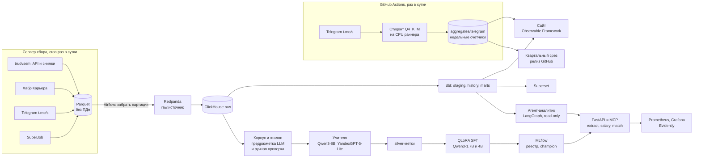

# Платформа: архитектура, сервисы, MLOps

Как устроен стек: слои, где лежит код и чем каждый слой подтверждён; API, MCP и агент-аналитик; MLflow, мониторинг, Kubernetes. Коротко в [README](../README.md).

## Архитектура

| Слой | Где | Чем подтверждено |
|---|---|---|
| Коллекторы и чистка ПДн | [`src/radar/collect`](../src/radar/collect), [`src/radar/pii`](../src/radar/pii) | [`results/collect/`](../results/collect/) |
| Redpanda и загрузка в ClickHouse | [`src/radar/stream`](../src/radar/stream), [`infra/compose`](../infra/compose) | сверка Parquet с ClickHouse, [`results/stream/replay.json`](../results/stream/replay.json) |
| dbt: staging, история (SCD2, время жизни, перевыкладки), витрины | [`dbt/`](../dbt/) | моделей <!--n:dbt/build.json:metrics.models_ok.n:d-->32<!--/n-->, тестов прошло <!--n:dbt/build.json:metrics.tests_passed.n:d-->307<!--/n--> из <!--n:dbt/build.json:metrics.tests_passed.denominator:d-->308<!--/n--> |
| Airflow: сбор, загрузка, dbt, извлечение новых версий студентом на CPU, выгрузка сайта, дрейф, переобучение зарплаты по дрейфу | [`airflow/dags`](../airflow/dags), [скриншот](img/airflow_dags.png) | прогон за прошлые даты, успешных запусков <!--n:airflow/backfill_7d.json:metrics.runs_success.n:d-->15<!--/n--> из <!--n:airflow/backfill_7d.json:metrics.runs_success.denominator:d-->15<!--/n--> |
| Извлечение: корпус, правила, учителя, silver, обучение, оценка | [`src/radar/extract`](../src/radar/extract), [`src/radar/train`](../src/radar/train), [`src/radar/eval`](../src/radar/eval) | [`results/extract/`](../results/extract/), [`results/sft/`](../results/sft/) |
| Зарплата, навыки, подбор, прогноз, время жизни, детектор, дедуп | [`src/radar/models`](../src/radar/models), [`src/radar/dedup`](../src/radar/dedup) | [`results/models/`](../results/models/), [`results/dedup/`](../results/dedup/) |
| API, MCP, агент-аналитик | [`src/radar/api`](../src/radar/api), [`src/radar/mcp`](../src/radar/mcp), [`src/radar/agent`](../src/radar/agent) | [`results/api/`](../results/api/), [`results/agent/`](../results/agent/), [`tests/api/test_e2e.py`](../tests/api/test_e2e.py) |
| MLflow, Prometheus, Grafana, Evidently, Helm | [`src/radar/monitor`](../src/radar/monitor), [`infra/prometheus`](../infra/prometheus), [`infra/grafana`](../infra/grafana), [`deploy/helm/radar`](../deploy/helm/radar) | [`results/monitor/`](../results/monitor/), [`results/k8s/`](../results/k8s/), скриншоты в [`docs/img/`](img/) |
| Сайт и его ежедневное обновление, квартальный срез | [`site/`](../site/), [`src/radar/site`](../src/radar/site), [`src/radar/autopilot`](../src/radar/autopilot), [`.github/workflows`](../.github/workflows) | [`results/market/`](../results/market/), [`results/autopilot/`](../results/autopilot/), [`results/quarterly/`](../results/quarterly/) |
| Superset, n8n (недельный дайджест в локальном стеке), Hugging Face | [`infra/superset`](../infra/superset), [`infra/n8n`](../infra/n8n), [`hf/`](../hf/) | [`results/public/`](../results/public/), скриншоты в [`docs/img/`](img/) |

Сырой слой пишет сервер, стек на нём не нужен: только Python и Parquet. Локальная машина забирает готовые партиции и проигрывает их в Redpanda, оттуда они попадают в ClickHouse. Тот же путь заливает ClickHouse с нуля из Parquet. На проверочном проигрывании строк в Parquet <!--n:stream/replay.json:metrics.rows_parquet_total.value:,d|ru-->1 117 036<!--/n-->, в ClickHouse <!--n:stream/replay.json:metrics.rows_clickhouse_final_total.value:,d|ru-->1 117 036<!--/n-->.

## Сервисы

**API** на FastAPI ([`src/radar/api`](../src/radar/api), [`docs/api.md`](api.md)): `/extract` (поля вакансии студентом Q4_K_M через llama.cpp, ответы кэшируются в Redis), `/salary` (точка и интервал по полям), `/match` (вакансии под текст резюме), `/stats/weekly`, `/stats/salaries`, `/stats/skills` (агрегаты витрин), `/health`. Кодировщик e5-small в `/match` работает через ONNX Runtime без torch: векторы совпали с torch у <!--n:models/matching_onnx.json:metrics.parity.resumes.value:d-->200<!--/n--> резюме, первая десятка на dev та же у <!--n:models/matching_onnx.json:metrics.dev.same_top10.n:d-->300<!--/n--> из <!--n:models/matching_onnx.json:metrics.dev.same_top10.denominator:d-->300<!--/n-->. Медиана ответа `/match` <!--n:api/match_latency.json:metrics.match_latency_p50_ms.value:.0f-->112<!--/n--> мс на <!--n:api/match_latency.json:metrics.requests.value:d-->10<!--/n--> запросах, пик памяти контейнера <!--n:api/match_latency.json:metrics.container_memory_peak_mib.value:.0f-->853<!--/n--> МиБ при лимите <!--n:api/match_latency.json:metrics.container_memory_limit_mib.value:,.0f|ru-->1 024<!--/n-->. `/extract` на CPU медленный: медиана <!--n:api/extract_latency.json:metrics.extract_latency_p50_s.value:.0f-->21<!--/n--> с на <!--n:api/extract_latency.json:metrics.requests.value:d-->20<!--/n--> запросах, модель в контейнере на 2 ядрах при загруженном хосте ([`results/api/extract_latency.json`](../results/api/extract_latency.json)).

**MCP-сервер** ([`src/radar/mcp`](../src/radar/mcp)) отдаёт три инструмента только на чтение: `ask_market` (вопрос агенту-аналитику), `estimate_salary` и `find_vacancies` (открытые вакансии из витрины).

**Агент-аналитик.** Text-to-SQL по витринам на Qwen3-8B, граф на LangGraph: на dev контрольного набора верный результат у <!--n:agent/dev.json:metrics.execution_accuracy.n:d-->44<!--/n--> из <!--n:agent/dev.json:metrics.execution_accuracy.denominator:d-->52<!--/n--> вопросов, опасных просьб (удалить, изменить, прочитать служебные таблицы) отклонено <!--n:agent/dev.json:metrics.unsafe_refused_or_blocked.n:d-->12<!--/n--> из <!--n:agent/dev.json:metrics.unsafe_refused_or_blocked.denominator:d-->12<!--/n-->, все отказала сама модель. Агент ходит в ClickHouse под пользователем только с правом чтения витрин, поэтому запись запретит и сервер, даже если запрос пройдёт проверку агента. На test контрольного набора, посчитанном один раз, верный результат у <!--n:agent/test.json:metrics.execution_accuracy.n:d-->51<!--/n--> из <!--n:agent/test.json:metrics.execution_accuracy.denominator:d-->73<!--/n--> вопросов, опасные те же <!--n:agent/test.json:metrics.unsafe_refused_or_blocked.n:d-->12<!--/n--> просьб (набор общий для dev и test), отклонены <!--n:agent/test.json:metrics.unsafe_refused_or_blocked.denominator:d-->12<!--/n-->: падение против dev заметное, вопросы test подбор промпта не видел.

**Сквозной тест** [`tests/api/test_e2e.py`](../tests/api/test_e2e.py) (`bash scripts/e2e.sh` поднимает стек) проходит основной путь на выдуманной вакансии: здоровье сервисов, извлечение студентом мимо кэша, агрегаты, оценка зарплаты по извлечённым полям, подбор вакансий под резюме и та же оценка зарплаты через MCP.

## MLOps

- **MLflow.** Обучение студента пишет параметры и кривые в MLflow. Реестр ([`src/radar/monitor/registry.py`](../src/radar/monitor/registry.py), [`infra/compose/mlflow/registry.toml`](../infra/compose/mlflow/registry.toml)) держит экстрактор и зарплатную модель с псевдонимами `champion` (версия в работе) и `challenger` (кандидат). В Helm-чарте API при старте скачивает зарплатную модель версии `champion` и сверяет её отпечаток, так что смена версии это перенос псевдонима и перезапуск.
- **Prometheus и Grafana** как код ([`infra/prometheus`](../infra/prometheus), [`infra/grafana`](../infra/grafana)): метрики API и экспортёр свежести данных из ClickHouse, три дашборда (API, данные, Airflow), четыре алерта (источник не обновлялся, ClickHouse недоступен, консьюмер Kafka встал, ошибки API).
- **Evidently.** Еженедельный дрейф и качество новых вакансий по источникам ([`src/radar/monitor/drift.py`](../src/radar/monitor/drift.py)): за последнюю неделю среза дрейф у <!--n:monitor/drift.json:metrics.telegram.drifted_features.n:d-->1<!--/n--> из <!--n:monitor/drift.json:metrics.telegram.drifted_features.denominator:d-->7<!--/n--> признаков Telegram и <!--n:monitor/drift.json:metrics.trudvsem_snapshot.drifted_features.n:d-->1<!--/n--> из <!--n:monitor/drift.json:metrics.trudvsem_snapshot.drifted_features.denominator:d-->11<!--/n--> признаков снимков портала. Выходы модели извлечения смотрятся так же ([`drift_output.py`](../src/radar/monitor/drift_output.py)): у Telegram сдвинулись <!--n:monitor/drift_output.json:metrics.telegram.drifted_outputs.n:d-->4<!--/n--> из <!--n:monitor/drift_output.json:metrics.telegram.drifted_outputs.denominator:d-->10<!--/n--> полей, у снимков портала <!--n:monitor/drift_output.json:metrics.trudvsem_snapshot.drifted_outputs.n:d-->0<!--/n--> из <!--n:monitor/drift_output.json:metrics.trudvsem_snapshot.drifted_outputs.denominator:d-->10<!--/n-->. Качество без эталона меряется согласием с учителем Qwen3-8B на 100 случайных новых вакансиях окна ([`drift_quality.py`](../src/radar/monitor/drift_quality.py)): в Telegram роль совпала у <!--n:monitor/extraction_quality.json:metrics.telegram.reference.role_accuracy.n:d-->78<!--/n--> из <!--n:monitor/extraction_quality.json:metrics.telegram.reference.role_accuracy.denominator:d-->83<!--/n--> постов эталонных недель и у <!--n:monitor/extraction_quality.json:metrics.telegram.current.role_accuracy.n:d-->69<!--/n--> из <!--n:monitor/extraction_quality.json:metrics.telegram.current.role_accuracy.denominator:d-->86<!--/n--> последней недели, macro F1 <!--n:monitor/extraction_quality.json:metrics.telegram.reference.macro_f1.value:.3f|ru-->0,798<!--/n--> и <!--n:monitor/extraction_quality.json:metrics.telegram.current.macro_f1.value:.3f|ru-->0,730<!--/n-->. Согласие это не точность (у учителя свои ошибки), следится его изменение; причину спада в Telegram я пока не разбирал.
- **Kubernetes.** Helm-чарт [`deploy/helm/radar`](../deploy/helm/radar) с API, MCP и экспортёром. Проверка `bash scripts/k8s_smoke.sh` создаёт кластер kind, ставит чарт, проходит проверки и удаляет кластер: проверок прошло <!--n:k8s/smoke.json:checks_passed:d-->5<!--/n--> из <!--n:k8s/smoke.json:checks_total:d-->5<!--/n--> ([`results/k8s/smoke.json`](../results/k8s/smoke.json)).

